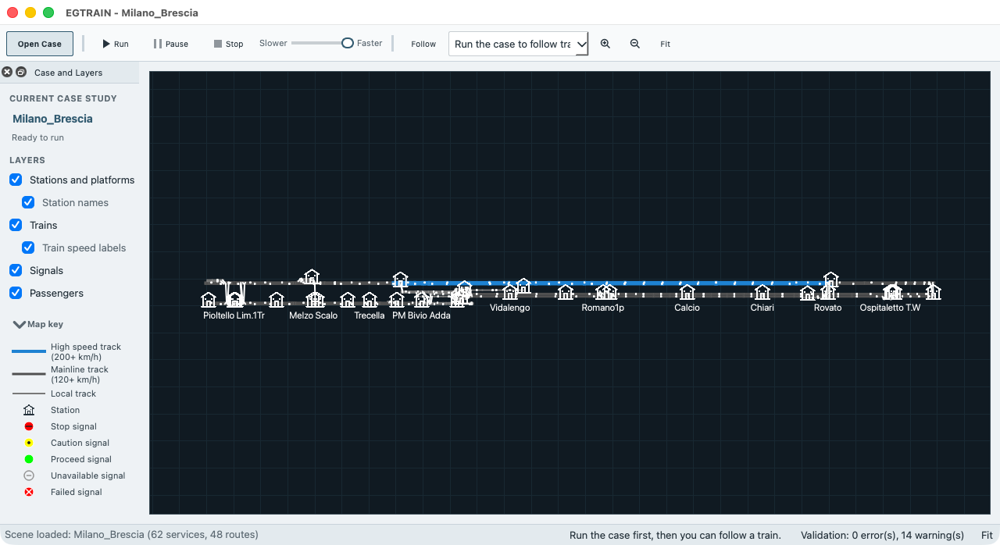
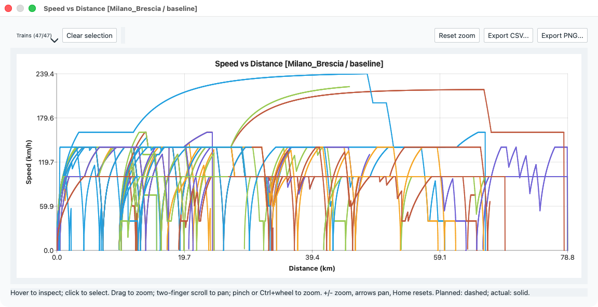

# EGTRAIN

EGTRAIN is a desktop application for microscopic railway simulation. It covers railway networks, signalling, rolling stock, services, timetables, train movement, passenger operations and results in an interactive Qt interface.

[Download](https://github.com/Ancientkingg/EGTRAIN/releases) | [Getting started](#quick-start) | [Documentation](docs/README.md) | [Report an issue](https://github.com/Ancientkingg/EGTRAIN/issues)

The loaded network of Milano_Brescia in the main window before a run.

## Quick start

1. Download the package for your system from the [releases page](https://github.com/Ancientkingg/EGTRAIN/releases): `EGTRAIN-<version>-macOS-arm64.dmg` (Apple silicon Macs with macOS 26 or later; [details](#macos-disk-image)), `EGTRAIN-Setup-<version>-x64.exe` or `EGTRAIN-Portable-<version>-x64.zip` (64-bit Windows; [choose one](#windows-installer-and-portable-archive)) or `QEGTRAIN-linux-x86_64.AppImage` (64-bit Linux). `<version>` is the version of the release. Download a case study file from the same page too, such as `Paimpol.egscene`.
2. Start the application.
   - macOS: open the disk image, drag `QEGTRAIN.app` onto `Applications` in its window, and open EGTRAIN from there. macOS refuses the first start of an ad hoc signed app; the [first start](#macos-disk-image) below says what to do.
   - Windows: run the installer and open **EGTRAIN** from the Start Menu, or unzip the portable archive into a new, empty folder and run `QEGTRAIN.exe` from it. Keep that folder intact. The Windows files are not code signed, so Windows warns before the installer starts; the [first start](#windows-installer-and-portable-archive) below says what to do, and [Code signing](docs/development/code-signing.md#windows-releases) explains the state and how to check a download.
   - Linux: make the AppImage executable and run it. On a minimal system that reports a missing library such as `libGL.so.1`, install `libgl1`, `libharfbuzz0b` and `libfontconfig1` first.
3. The application first shows the **Open a Case** window over the case that is already loaded; choose a case in it or continue with the loaded case, and answer any first-start question. Then open the case study with **File > Open Case Study...** and select the downloaded file.
4. Run it with **Simulation > Run** (or **Run** on the toolbar) and confirm the **Run simulation** window.
5. When the run ends, open the **Diagrams** menu for the results, for example **Speed / distance**. The result windows have **Export CSV...** and **Export PNG...**.

[Opening an `.egscene` case study](docs/guides/opening-a-case-study.md) has the details. [Command-line options and scene_tool](docs/guides/command-line.md) covers headless runs, options and the output folder.

### macOS disk image

`EGTRAIN-<version>-macOS-arm64.dmg` holds `QEGTRAIN.app` and `Applications`, a shortcut to the Applications folder. It needs an Apple silicon Mac with macOS 26 or later. Releases up to v1.0.2 offer the app as `QEGTRAIN-macos-arm64.zip` instead.

- **Install.** Open the image and drag `QEGTRAIN.app` onto `Applications`, then eject the image. The app is self-contained and needs no installer, so a copy in any other folder that you can write to works the same way. Run EGTRAIN from a copy and not from the image: an app on the image is read-only and cannot update itself.
- **First start.** Unless the release notes say that the app is notarized, expect that it is not notarized by Apple and that macOS refuses the first start with `"QEGTRAIN" Not Opened`, which offers **Move to Trash** and **Done**. To allow the app, choose **Done**, open **System Settings > Privacy & Security** and, in the section **Security**, choose **Open Anyway** for `"QEGTRAIN" was blocked to protect your Mac.` Choose **Open Anyway** again in `Open "QEGTRAIN"?`. macOS then asks for the name and password of an administrator. These are the dialogs of macOS 26.6; other versions may word them differently. This is the normal macOS override. Do not turn Gatekeeper off or remove the download mark with a command.
- **Notarized releases.** When the release notes say that the app is signed with a Developer ID and notarized, macOS is expected to ask only for the usual confirmation for an app that was downloaded. [Code signing](docs/development/code-signing.md#macos-releases) explains both kinds of release.
- **Open a case study.** Double-click an `.egscene` file in Finder to open it in EGTRAIN, or Control-click it and choose **Open With** and `QEGTRAIN`. When EGTRAIN is open, the file opens in its window. [Open by double-click](docs/guides/opening-a-case-study.md#open-by-double-click) has the details.
- **Update.** For a copy outside the image, **Help > Check for Updates...** offers **Update and Restart** when a newer release exists.
- **Remove.** Quit EGTRAIN and drag `QEGTRAIN.app` to the Trash. Your case studies, your exported files and the settings of EGTRAIN stay.
- **Inside the app.** The case studies are in `QEGTRAIN.app/Contents/Resources/Scenes`, the Lebanon guide is `Contents/Resources/lebanon-case-study.md` and the command-line tool is `Contents/MacOS/scene_tool` (see [Command-line options and scene_tool](docs/guides/command-line.md)). The image shows no other file.

### Windows installer and portable archive

The installer and the portable archive hold the same application files. Choose the installer to have EGTRAIN in the Start Menu and in the list of installed apps. Choose the archive to run EGTRAIN from a folder without installing anything. Releases up to v1.0.2 have no installer and offer the archive as `QEGTRAIN-windows-x64.zip`.

- **Install.** `EGTRAIN-Setup-<version>-x64.exe` installs for the current user and needs no administrator rights. The default folder is `%LOCALAPPDATA%\Programs\EGTRAIN`, and the wizard offers another folder on a first install. It adds the Start Menu entry **EGTRAIN**, an entry in the list of installed apps in Windows Settings and, only if you tick it, a desktop shortcut. It also registers EGTRAIN for `.egscene` files of your user, so a double-click opens them in EGTRAIN unless you chose another program for them with **Open with**.
- **First start.** The Windows files are not code signed. On Windows 11 in October 2026, with files that carried the download mark, starting the installer showed the dialog `Windows protected your PC` with the text `Microsoft Defender SmartScreen prevented an unrecognized app from starting. Running this app might put your PC at risk.` Its only buttons are a **More info** link and **Don't run**. **More info** shows `App: EGTRAIN-Setup-<version>-x64.exe` and `Publisher: Unknown publisher`, and adds **Run anyway**, which starts Setup. No administrator prompt follows. The dialog comes back each time you start Setup. The portable `QEGTRAIN.exe`, extracted with **Extract All**, started without a warning in the same test. Other Windows versions may word this differently. Do not turn SmartScreen off. [Code signing](docs/development/code-signing.md#windows-releases) has the details.
- **Upgrade.** Run the Setup of the newer version over the installed copy. It updates that installation and does not add a second one. Setup offers to close EGTRAIN if it is running. It replaces the `Scenes` folder of the installation, so keep your own cases outside it. **Update and Restart** in an installed copy does the same for you: it downloads the Setup of the newer version, closes EGTRAIN, runs the Setup without windows and starts EGTRAIN again, which then tells you which version runs.
- **Uninstall.** Remove EGTRAIN from the list of installed apps in Windows Settings. This removes the program files, the shortcuts, the entry in the list and the `.egscene` setting that the installer made. Your case studies, your exported CSV and PNG files, the run output (see the [output folder](docs/guides/command-line.md#output-folder)) and the settings of EGTRAIN stay. A file that you or the program put into the installation folder stays, and so does the folder.
- **Portable archive.** `EGTRAIN-Portable-<version>-x64.zip` needs no installation and no administrator rights. Unzip it into a new, empty folder and run `QEGTRAIN.exe`. It adds no Start Menu entry, no shortcut, no entry in the list of installed apps and no setting for `.egscene` files. To remove it, close EGTRAIN and delete the folder. To use a newer version, unzip the newer archive into another new folder, or use **Update and Restart** in EGTRAIN.

## What you can do

- Infrastructure and signalling: view tracks, stations, signals and routes in a graphical scene, and give sections a signalling level with signalling areas.
- Rolling stock, services and timetables: inspect and edit trains, services and timetables.
- Simulation: simulate train movement over signalled infrastructure, including delays and passenger operations.
- Scene editing and validation: edit scenes, validate them before a run, and import legacy cases.
- Results and exports: review timetable, train-path, delay, speed, trajectory and blocking-time results, and export them as CSV and PNG files.

The Speed / distance result window of Milano_Brescia (baseline, 47 trains) after a run.

## Case studies

| Case study | Release file | Tracks | Stations | Services | Note |
| --- | --- | ---: | ---: | ---: | --- |
| Netherlands | `Netherlands.egscene` | 268 | 41 | 8 | Every service ends at its last stop: the train leaves the network after its dwell. |
| Paimpol | `Paimpol.egscene` | 6 | 10 | 2 | Paimpol, France. Includes passenger data. |
| Copenhagen | `Copenhagen.egscene` | 168 | 94 | 24 | Copenhagen, Denmark. |
| Milano_Brescia | `Milano_Brescia.egscene` | 38 | 29 | 62 | Milan to Brescia, Italy. The gradients are stored as rise per length; their unit was inferred as per mille and their source is not recorded. |
| Assignment Gvc-Gdg-Ut | `Assignment_Gvc_Gdg_Ut.egscene` | 2 | 3 | 4 | Synthetic two-track fixture, not a distributable TU Delft case. |
| Lebanon | `Lebanon.egscene` | 8 | 34 | 1 | Teaching baseline; the train parameters are not Lebanon rolling-stock data. The gradients are stored as rise per length; their unit was inferred as per mille and their source is not recorded. |
| Amsterdam_Hilversum_Student | `Amsterdam_Hilversum_Student.egscene` | 268 | 41 | 1 | Fictional teaching timetable on the Netherlands network, added after release v1.0.2. See the [student case guide](docs/guides/amsterdam-hilversum-student-case.md). |

The counts are the numbers of entries in `infrastructure.json` (tracks), `stations.json` (stations) and `services.json` (services), so they can differ from the number of trains in a result window. The scene folders are in `EGTRAIN/QEGTRAIN/Scenes` in the repository and inside the application packages.

## Credits and research background

EGTRAIN was originally developed by Prof. [Egidio Quaglietta](https://orcid.org/0000-0002-7936-5832) as a microscopic railway simulation model. Its foundations and early applications are described in his [doctoral thesis](https://doi.org/10.6092/unina/fedoa/8599).

[Samuel Bruin](https://samuelbruin.com/) ([GitHub profile](https://github.com/Ancientkingg)) continues development and maintenance of the desktop application in this repository.

The original EGTRAIN case-study inputs for the SORTEDMOBILITY research project are available from [4TU.ResearchData](https://doi.org/10.4121/e78d0dc2-3123-4510-a2c5-7ad017a02e33.v1).

## Documentation and development

- Run a case study: [Opening an `.egscene` case study](docs/guides/opening-a-case-study.md) and [Command-line options and scene_tool](docs/guides/command-line.md).
- Create or edit scenes: [Using EGTRAIN and authoring V1 scenes](docs/guides/scenes-and-application.md) and [V1 scene properties](docs/guides/v1-scene-properties.md).
- Build the application from source: [Getting started as a developer](docs/development/getting-started.md).
- Build, test and contribute: [Build And Test](docs/development/build-and-test.md), [Coding guidelines](docs/development/coding-guidelines.md), [V1 Scene Model](docs/architecture/scene-model.md) and, for the repository layout, [QEGTRAIN source layout](docs/architecture/source-layout.md#repository-layout).

EGTRAIN is a C++17 application built with Qt 5 and CMake. See [Documentation](docs/README.md) for the full list.

## Support

Report problems in [GitHub Issues](https://github.com/Ancientkingg/EGTRAIN/issues). Please include the application version, your operating system, the steps to reproduce the problem, and what you expected against what happened.

Do not upload private project data, such as case study files, logs or screenshots with data you do not want to share, unless it is needed to explain the problem. Remove what you do not want to share.

## License

EGTRAIN's source code is licensed under the
[GNU General Public License, version 3 only](LICENSE)
(`GPL-3.0-only`).

Third-party components retain their own licenses. The code license does not
cover case-study datasets or grant rights to third-party assets; their
respective terms and permissions apply.
