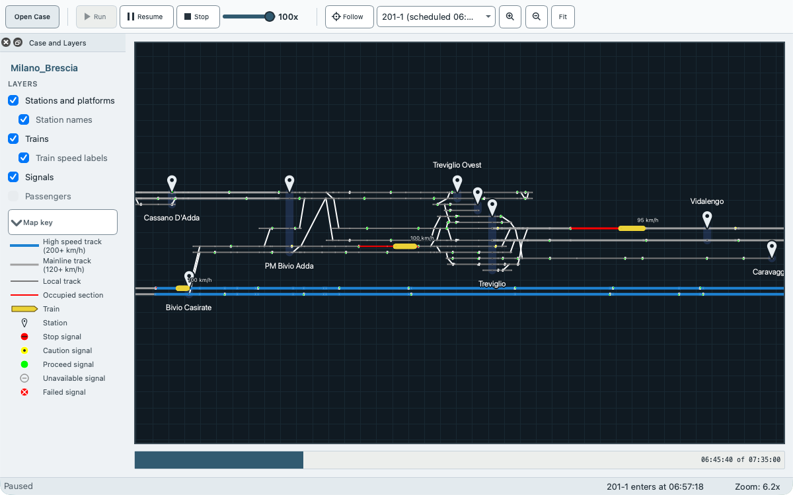

# EGTRAIN

EGTRAIN is a desktop application for microscopic railway simulation. It covers railway networks, signalling, rolling stock, services, timetables, train movement, passenger operations and results in an interactive Qt interface.

[Download](https://github.com/Ancientkingg/EGTRAIN/releases) | [Install](docs/guides/install.md) | [Getting started](docs/guides/getting-started.md) | [Documentation](docs/README.md) | [Report an issue](https://github.com/Ancientkingg/EGTRAIN/issues)

The loaded network of Milano_Brescia in the main window before a run.

## What you can do

- Infrastructure and signalling: view tracks, stations, signals and routes in a graphical scene, and give sections a signalling level with signalling areas.
- Rolling stock, services and timetables: inspect and edit trains, services and timetables.
- Simulation: simulate train movement over signalled infrastructure, including delays and passenger operations.
- Scene editing and validation: edit scenes, validate them before a run, and import legacy cases.
- Results and exports: review timetable, train-path, delay, speed, trajectory and blocking-time results, and export them as CSV and PNG files.

## Credits and research background

EGTRAIN was originally developed by Dr.ir. [Egidio Quaglietta](https://orcid.org/0000-0002-7936-5832) as a microscopic railway simulation model. Its foundations and early applications are described in his [doctoral thesis](https://doi.org/10.6092/unina/fedoa/8599).

[Samuel Bruin](https://samuelbruin.com/) ([GitHub profile](https://github.com/Ancientkingg)) continues development and maintenance of the desktop application in this repository.

The original EGTRAIN case-study inputs for the SORTEDMOBILITY research project are available from [4TU.ResearchData](https://doi.org/10.4121/e78d0dc2-3123-4510-a2c5-7ad017a02e33.v1).

## How to cite

To cite EGTRAIN, use **Cite this repository** in the sidebar of the [GitHub repository](https://github.com/Ancientkingg/EGTRAIN). It is built from [`CITATION.cff`](CITATION.cff).

## Documentation and development

- Install and run a first case: [Installing EGTRAIN](docs/guides/install.md) and [Getting started](docs/guides/getting-started.md).
- Run a case study: [Case studies](docs/guides/case-studies.md), [Opening an `.egscene` case study](docs/guides/opening-a-case-study.md) and [Command-line options and scene_tool](docs/guides/command-line.md).
- Create or edit scenes: [Editing and validating a case](docs/guides/editing-a-case.md) and the [V1 scene schema reference](docs/guides/scene-schema.md).
- Build the application from source: [Getting started as a developer](docs/development/getting-started.md).
- Build, test and contribute: [Build And Test](docs/development/build-and-test.md), [Coding guidelines](docs/development/coding-guidelines.md), [V1 Scene Model](docs/architecture/scene-model.md) and, for the repository layout, [QEGTRAIN source layout](docs/architecture/source-layout.md#repository-layout).

EGTRAIN is a C++17 application built with Qt 5 and CMake. See [Documentation](docs/README.md) for the full list.

## Support

Report problems in [GitHub Issues](https://github.com/Ancientkingg/EGTRAIN/issues). Please include the application version, your operating system, the steps to reproduce the problem, and what you expected against what happened.

Do not upload private project data, such as case study files, logs or screenshots with data you do not want to share, unless it is needed to explain the problem. Remove what you do not want to share.

## License

EGTRAIN's source code is licensed under the
[GNU General Public License, version 3 only](LICENSE)
(`GPL-3.0-only`).

Third-party components retain their own licenses, which
[THIRD_PARTY_NOTICES.md](THIRD_PARTY_NOTICES.md) lists for the libraries in the release packages. The code license does not
cover case-study datasets or grant rights to third-party assets; their
respective terms and permissions apply. The terms of each case study are in
[DATA.md](DATA.md).
