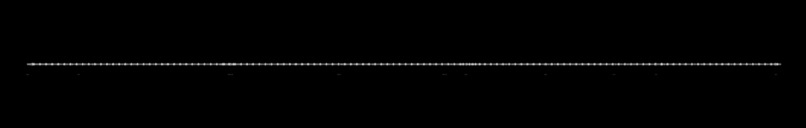
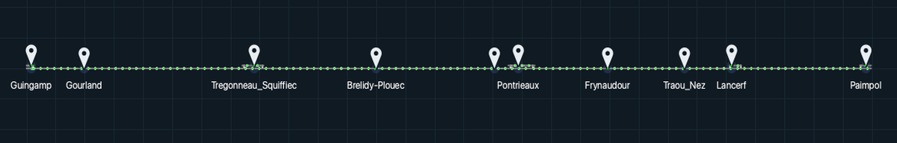
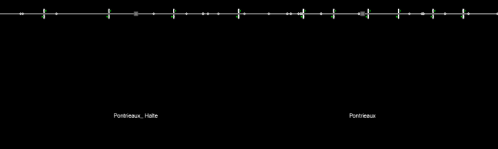
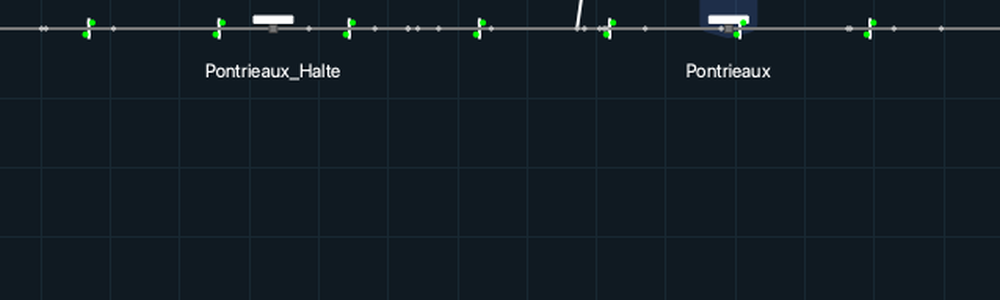
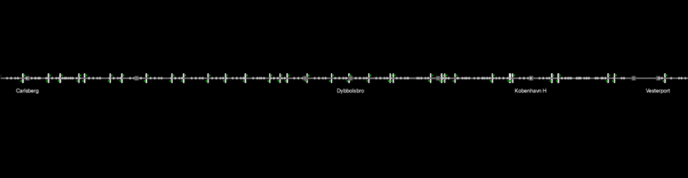
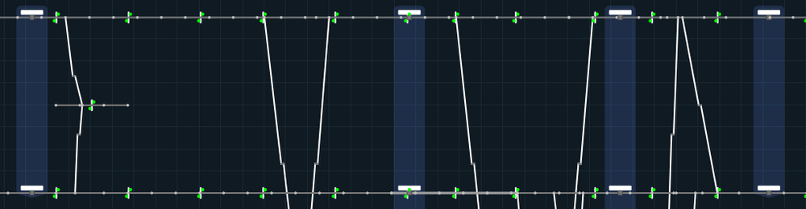
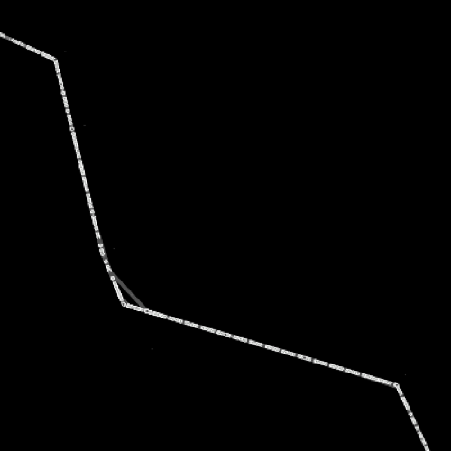
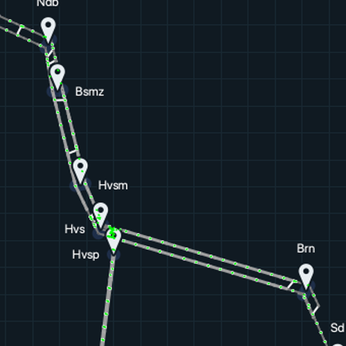
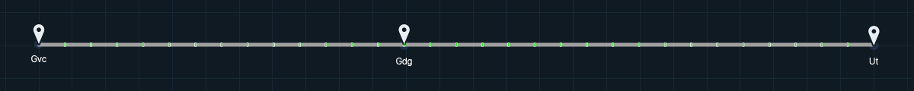
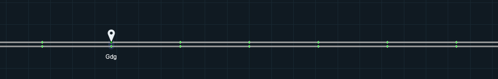

# Historical track presentation

The visual reference is the initial imported renderer `472d0b5`, particularly
`paintNode`, `paintStationNode`, `paintStationIcon`, `paintStationName`,
`arcDrawing`, `paintConnection`, `paintSignal` and `paintTrain`. The later
`f138134` manifest repair does not change these symbols. The
[renderer style map](renderer-style-map.md) gives the historical function of each
primitive next to the way it is drawn now.

Canonical authored geometry and Fit padding remain in use, so comparisons must
distinguish geometry from symbol presentation. Station artwork uses a mark per
station class with the historical parent. At scene scale it keeps the historical
anchor and offset; on the canvas it is placed by the station squares at the
place of the station. Zoomed out the mark is a map pin on a faint area of the
station; zoomed in the pin gives way to the station squares, the platform bars
and the area. Its frame on screen is at least 24 px and the name at least 12 px,
so stations stay locatable at Fit; above that the scene size applies. The name
goes under the squares, or off the tracks above the pin or beside the squares.
Overlapping names are hidden by priority and marks are never hidden. The
historical passenger PNG is restored as a separate resource. Train polygons keep
the historical construction; their colour is one default yellow, or the colour
of the service. The original renderer did not paint a train category badge over
the locomotive.

## Intentional differences

These are the only intentional differences from the reference renderer. A
difference that is not listed here is not intended. The numbers are the pull
requests that made the change, or the issue where none did.

- Station pictogram and its size on screen (#579, #822, #1063). A map pin with
  a dark halo replaces the raster `station_pixmap`. Until the tracks at the
  stations are 12 logical pixels apart on screen the pin shows: a small dark pin
  with a light edge and dot for a station without a platform, a light pin with a
  dark dot for one with a platform and a larger blue pin with a light edge and
  dot for one with three or more connections. Its tip stands on the upper edge
  of the hull of the station squares, above their middle, and so on the faint
  blue area that covers the squares, also where the squares run diagonally.
  Closer in a station with squares at its place draws no pin: the station
  squares, the platform bars and the area show, and the area also covers the
  bars. A station without such a square keeps its pin, and closer in that pin
  and its name keep their smallest size on screen. A run without the shared
  preview does not count connections and draws no major station. The name sits
  under the station, or above the pin or beside the squares where its text
  would cross a track. At every zoom the frame of the pin is at least 24 px and
  the name at least 12 px, and names that overlap are hidden by rank. Where the
  scene size is larger than that, the scene size applies, as in the reference.
  A name has a halo of 2 logical pixels in the canvas colour around its letters
  and is stacked over the tracks, the pins and the trains, so that it stays
  readable where no free spot is left. The reference stacked the trains over
  the names.
- Canvas (#509). The background `#101a22` with a faint `#182832` grid replaces
  the solid black background.
- Selection (#606). A ring in the cue colour (61,214,255) marks the selected
  item. The reference recoloured the item blue with `myQGraphicsColorizeEffect`.
- Train colours (#549, #555, #572). One default yellow, (235,210,55) with
  outline (110,90,20), replaces the keyword colours that `classifyTrainType`
  gave to freight, high speed, sprinter and intercity trains. It is the colour
  the reference gave every other train. A service with a valid colour overrides
  it on the canvas (#555) and in the result windows (#572).
- Signal head states (#586). A head without signalling data is an empty gray
  ring and a failed head is a red lamp. A head at least 6 device pixels wide also
  draws a mark: a white cross on a failed head, a dark bar on Stop, a dark dot on
  Caution and a short gray dash in the ring. The reference painted every head
  green, yellow or red and kept the colour for a code it did not know. Only a lit
  head, every state except the gray ring, has the hairline outline of the
  reference; below 6 device pixels a lit or failed head is a disc in its lamp
  colour without an outline. Heads in the preview before a run stay green.
- Presentation scale (#422). Symbol sizes, text and offsets are converted from
  the historical construction units by the factor `k` described under
  [Measured presentation units](#measured-presentation-units).
- Mainline track grey (#822). Track of 120 km/h and above is (160,160,160) with
  width 3. The reference draws it (80,80,80), a contrast of 2.18:1 against the
  canvas, which is less than the 3:1 target and less than the local track
  (3.99:1). The new grey has 6.73:1.
- Train size on screen (#822). A body the view shows thinner than 8 logical px
  is stroked to 8 px in its fill colour with round corners, and a click on the
  mark selects the train. Signal heads keep their 6 px rule.
- Station name spacing (issue #387). `StationOverlayItem::displayName` puts a
  space before a capital that follows a lowercase letter and before the capital
  that starts a word after an acronym. The reference put a space before every
  capital after the first letter, so `KBHallen` reads "KB Hallen" instead of
  "K B Hallen" and `Pontrieaux_Halte` has no space after the underscore. In the
  committed scenes this changes 4 of the 10 names in Paimpol and 5 of the 94 in
  Copenhagen.
- Train speed. From a zoom of 3x, and for a selected or followed train at any
  zoom, the speed of a train is white 8 pt text with a dark (16,26,34) outline
  of 1 logical pixel, 8 logical pixels right of and above the centre of the
  train, at the same size at every zoom. **Train speed labels** hides it. The
  reference drew a black `addSimpleText` label at scene scale beside every
  running train, at its centre plus (6,-18) scene units.
- Track states (issue #387). Occupied, blocked and prepared sections are kept in
  the scene data and shown in the arc inspector. In a run and a replay
  `TrackLineItem::paint` draws an occupied line plain red (255,0,0) at the width
  of its speed class, and prepared and blocked lines in their speed colour. The
  reference tinted a block occupied by a train with a red colour effect and had
  no prepared or blocked state. An occupied line in a section that a signal
  failure blocks is red as well; the arc inspector shows it as blocked.
- Running state (issue #387). The reference gave every track a white colour
  effect at the start of each step, in `releaseBlockOccupationStatus`. The
  current renderer keeps the speed-class colours during a run, apart from the
  red of the occupied lines.
- Platform bars. Every platform of a station that is not virtual has a white
  bar, in the preview and in every run, shown once the stations are in the
  closer look. The reference drew the bars only in passenger-GUI mode. The
  passenger counters and icons still need a run with passengers and
  **Passengers** on, and they show only on bars that show.

## Geometry and data differences

These differences come from the canonical scenes or from the historical input,
not from the renderer, and are not on the list above.

- Paimpol: the current build draws a siding above the line at Pontrieaux, with
  signals of its own, joined to the main line by a diagonal connection at each
  end. The current Fit frame shows it as a short second row above the line; in
  the detail frame it lies above the top edge. The reference frames of the same
  line show the main line only. The Paimpol historical blank mainline level and
  Guingamp anchor mismatch remain excluded layout and data differences.
- Copenhagen: the reference frame draws one line where the current frame draws
  two parallel rows joined by crossovers. Canonical geometry draws every authored
  segment except the first and last arc of the 137 four-node tracks that
  `views.json` marks as double switches, which the reference also leaves out.
- Netherlands: the reference frame draws a single line where the current frame
  draws doubled tracks and crossovers. The reference build `472d0b5` opens this
  case without trains and draws only part of the polyline, so the pair uses
  `f138134`, the same renderer with a repaired Netherlands case.

## Preview and runtime infrastructure

Normal Open now draws semantic track, connection, ordinary-node and station-node
items before Run, using the same paint classes as prepared runtime. Preview and
run draw the connections first and the track lines over them with the same pens,
and a lit signal head has a hairline outline in both, or below 6 device pixels
a disc in its lamp colour without one. Preview has canonical
string identities and read-only inspectors, not native simulation objects.
Preview and run draw the white platform bars of every platform outside the
virtual stations; preview does not invent passenger counters. Inspection does
not select an editor row or modify authored geometry. Rebuild, replacement and
Run clear preview inspection and close menus; delayed menu actions re-resolve
identities with revision and mode guards.

For runnable directed chains, preview mirrors the current runtime node rule:
the first point is ordinary even if a station belongs there; ordinary start
points on a four-node track have zero painted size, while station overrides at
later points and the final endpoint remain visible. Invisible ordinary nodes
retain picking targets. Four nodes alone do not establish a Copenhagen double
switch; a track view with `double_switch` does. Preview and run draw such a
track without its first and last arc and paint none of its ordinary nodes, as
the reference drew every four-node track of `Input/Input_EGTRAIN_Banedanmark`.
The simulation keeps every arc, and every other track keeps all its authored
segments. Malformed fallback chains have safe authoring preview coverage, not a
prepared-runtime equivalence claim.

Station artwork retains its own canonical identity, including duplicate names
and position-only stations. Platform membership follows authored-order native
field assignments; a later position-only membership replaces the station but
retains any prior platform. Position-only artwork searches visible cached lines
in authored order. Positions outside every visible line remain unsupported for
comparison. Artwork and name visibility do not hide structural station squares.

Offscreen semantic, identity, lifetime and prepared-runtime checks are not
calibrated visual acceptance. The [evidence](#evidence) lists the captures that
compare the two renderers and what they do not cover.

## Measured presentation units

Historical projection construction used width 100, height 30 and `geo_scale`
800000 in Paimpol, Netherlands and Copenhagen. The renderer uses that fixed
reference convention, `Q_h = 800000 * 100 / 360`, not the current window size or
Fit scale. TrackPreview records its actual coordinate normalization `S_c` and
converts historical presentation distances by `k = S_c / Q_h`. On the committed
scenes this gives Paimpol 0.45, Netherlands approximately 0.444237158 and Copenhagen
approximately 0.397828422. Assignment has no historical capture reference.

Conversion requires every visible nonempty line to complete the authored
station-view projection, whether schematic or geographic. Raw coordinates,
missing views, invalid anchors, mixed/partially mapped scenes, empty or degenerate
extents and nonfinite normalization retain presentation factor 1 for the whole
scene. Hidden lines do not qualify or disqualify the visible scene. Normalization
is idempotent, including its unit metadata; edits rebuild from the scene model.

Station artwork, its vertical gap, text metrics, derived annotation offsets and
named nudges, structural nodes, signal heads/lateral separation, platforms,
passenger adornments, train thickness and callout decoration use this shared
conversion. On a schematic line, one that the station views of its region place
at a single latitude, the annotation offset of a station with a named nudge is
the exception: it counts in the reference spacing of the levels, so the name
stays between the rows of track it was placed between.
Original font and pixmap metrics are retained with fractional item
scaling. Authored coordinates, levels, track geometry, physical train head/tail
and length, and signal center/longitudinal +/-8 metre anchors do not scale again.
Track, connection and signal strokes stay cosmetic. Picking areas are preserved.
The Paimpol historical blank mainline level and Guingamp anchor mismatch remain
excluded layout/data differences, not presentation calibration inputs.

Focused unit and offscreen preview/prepared-runtime fixtures verify these unit
boundaries. They do not establish full historical visual acceptance or replace
matched-extent application captures and manual interaction checks.

## Evidence

Each pair below shows the same stretch of the network in the reference build and
in the current build, at the same size in pixels. All frames are at device pixel
ratio 1: the reference frames from 1280x800 windows, the current frames from the
offscreen platform with the canvas at 1254x566, its size in such a window. Each
image is a crop of the network canvas, resized so that the two frames of a pair
show the same extent. The zoom given for a pair is the zoom of the window before
the crop, so a frame can show the network larger or smaller than the window did,
and the sizes in a Fit frame and in a detail frame are not in the ratio of their
zooms. The reference builds are `472d0b5` and, for the Netherlands, `f138134`.
The current build is main `3bdaa4919`. Both builds zoom by 1.15 per click. The
zoom label of the current build is the ratio to its own Fit scale. The reference
build has no zoom label, so its zoom is the number of zoom-in clicks from Fit.
The reference build fits the scene rectangle and the current build fits the
painted track with 24 px of padding, so the same number of clicks from Fit does
not show the same extent in both builds.

Under each pair the first paragraph gives the build, the scene, the zoom and the
landmarks, and the second says what differs inside the pair: the symbols first,
then the geometry. The geometry differences come from the scenes, not from the
renderer; [Geometry and data differences](#geometry-and-data-differences) lists
them.

### Paimpol at Fit

Reference build `472d0b5` above, current build main `3bdaa4919` below. Scene
Paimpol at Fit in both builds, so the whole line shows, with Guingamp at the left
end and Paimpol at the right end. The positions of the ten stations agree within
about 0.5 percent of the frame width.

In the symbols, the current frame draws a light map pin with a dark dot above
the line at each station, its tip on the faint blue area of the station, and a
readable name under the line. It hides the name of Pontrieaux_Halte where it
overlaps the name of Pontrieaux. The reference frame has no station mark and
names too small to read. In the geometry, the siding at Pontrieaux shows in the
current frame only, as a short second row above the line.

### Paimpol at detail

Reference build `472d0b5` above, current build main `3bdaa4919` below. Scene
Paimpol, 16 zoom-in clicks from Fit (zoom label 9.4x in the current build), then
10 arrow-key presses in both builds. Pontrieaux_Halte and Pontrieaux stand at the
same x in both frames, and the line, its signals and its node dots line up within
1 px.

In the symbols, the current frame draws each signal head as a green disc, larger
than the heads of the reference frame, and a white platform bar above each
station square. At Pontrieaux the faint blue area of the station runs from the
top edge to just below the line. The current frame writes each name under its
square, larger because the minimum name size applies at this zoom, and writes
Pontrieaux_Halte without the space after the underscore that the reference frame
draws. In the geometry, the current build draws the siding at Pontrieaux above
the line, beyond the top edge of this frame: only the foot of its left diagonal
connection shows. The reference frame draws three signals on the line right of
that connection, at the x positions of the signals of the siding.

### Copenhagen junction

Reference build `472d0b5` above, current build main `3bdaa4919` below. Scene
Copenhagen, 22 zoom-in clicks from Fit (zoom label 21.6x in the current build),
then 10 presses of the right arrow key in both builds and, in the current build,
6 of the down arrow key, because its two rows start lower in the window.
Carlsberg, Dybbolsbro, Kobenhavn H and Vesterport stand at the same x in both
frames, within 3 px.

In the symbols, the current frame draws a white platform bar above each station
square of both rows, and the faint blue area of each station, which covers the
squares and bars of both rows and, at Dybbolsbro and Kobenhavn H, runs on below
the frame. The names of these stations stand under their lowest square, below
the frame, so the current frame shows no name. In the geometry, the reference
frame draws one line, with signals at more x positions than either current row,
where the current frame draws two parallel rows joined by crossovers. The
signals of both current rows stand at x positions where the reference line
has a signal.

### Netherlands stretch

Reference build `f138134` above, current build main `3bdaa4919` below. Scene
Netherlands, 6 zoom-in clicks from Fit (zoom label 2.3x in the current build).
The landmarks are the track corner at Ndb, the corner between Hvsm and Hvsp and
the corner at Brn, which agree within about 20 px in the 500 px frames. This is
the loosest match of the pairs, because the current case has doubled tracks.

In the symbols, the current frame draws a light map pin with a dark dot at each
station, its tip on the tracks, with the name off the tracks: above the pin at
Brn and at Ndb, where the top edge cuts off the top of the letters, and beside
it at Bsmz, Hvsm, Hvs and Hvsp. The name of Sd shows in the lower right corner,
with only the top of its pin at the bottom edge. The mainline track is grey
(160,160,160), and the reference frame has no readable station label. In the
geometry, the current frame draws doubled tracks and crossovers where the
reference frame draws a single line, with one short extra segment at the corner
between Hvsm and Hvsp.

### Assignment corridor

The reference build has no capture of this scene, so only the current build is
shown.

Current build main `3bdaa4919`, scene Assignment_Gvc_Gdg_Ut. The first frame is
at Fit with the stations Gvc, Gdg and Ut, each a light map pin with a dark dot
above the line with its name under it, and the two parallel mainline tracks of
the corridor, grey (160,160,160), read as one band. The second frame is 10
zoom-in clicks from Fit (zoom label 4x), around Gdg, and shows the two tracks
apart, with a signal on each track at regular intervals. The tracks are about
8 px apart there, less than the 12 px at which the station squares and platform
bars replace the pin, so Gdg keeps its pin above the upper track and its name
under the lower one.

### What the captures show and do not show

- The reference frames show the station names and no station mark, so the
  pins, platform bars and station areas of the current frames have no
  counterpart in them. At Fit the names in the reference frames are too small
  to read, where the current build keeps the frame of the station mark at least
  24 px and the name at least 12 px high.
- The names are larger in the current Paimpol detail frame than in the reference
  frame at the same extent. The current build draws a name at least 12 px high.
- The current frames have the `#101a22` background and its grid, the reference
  frames a black background.
- In both Paimpol detail frames a signal has a white post and base and a green
  head, and the opposing head sits on the other side of the line at the same
  offsets. Node dots are light gray (192,192,192) and sit at the ends of the track
  segments. Both builds draw the track with a cosmetic pen of 2 px.
- No capture shows a running state, so the trains, which keep at least 8 px on
  screen, their speed, the red and yellow aspects, the red occupied lines and
  the white repaint of the reference are not shown.
- Interaction (hit testing, signal inspection, layer toggles, Follow, zoom and
  pan) and the run, pause, stop and replay states are not shown by these
  captures.
