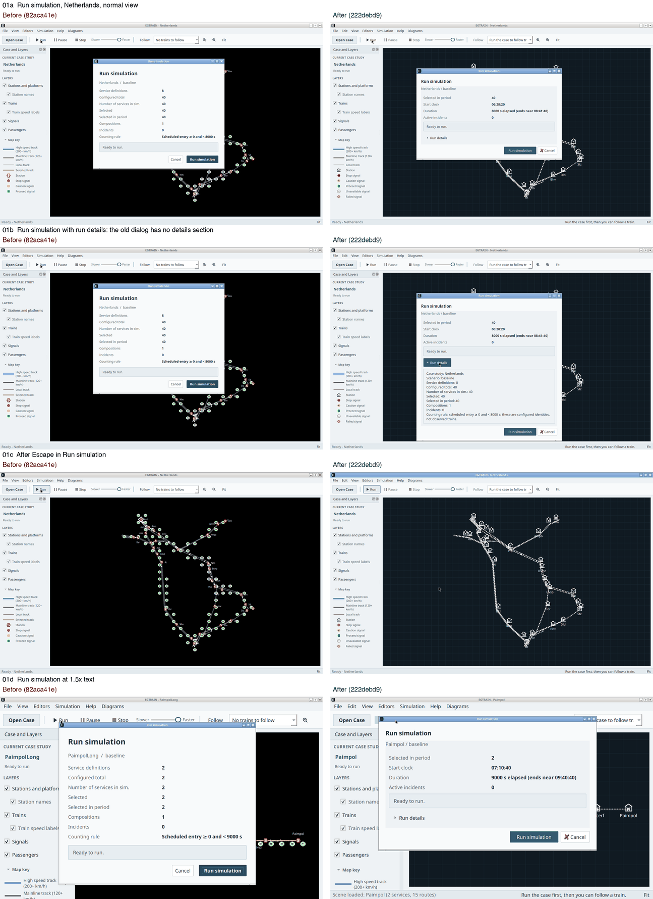
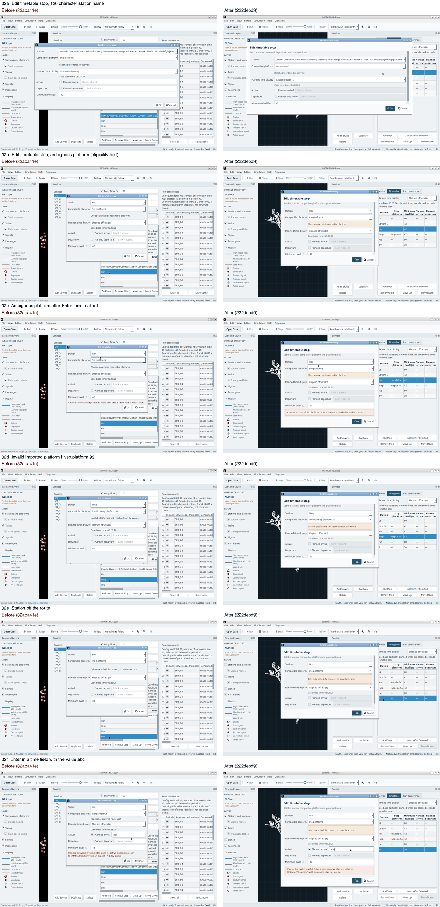
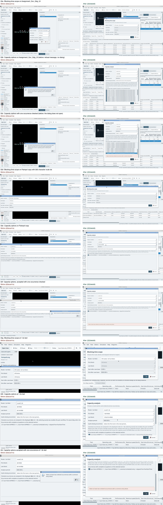
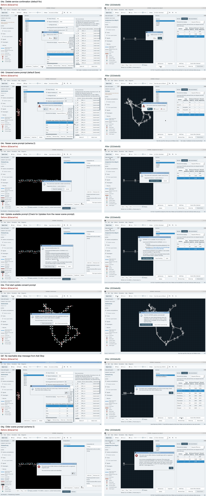
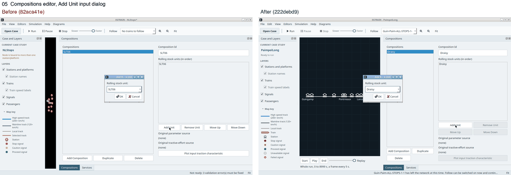
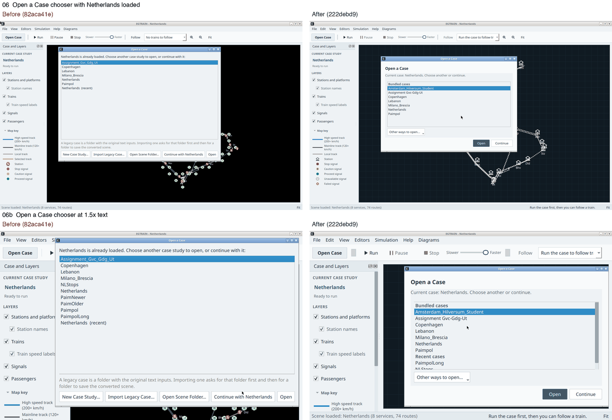

# Dialog sheet 2026-10-17

This page compares the custom dialogs before and after the work on a shared dialog presentation. Each row shows the whole screen of the same state twice: on the left the build `82aca41e`, before the dialogs used `DialogLayout`, and on the right the build `222debd9`. It is a dated record and is not kept up to date. The rules the dialogs follow are in the [dialog presentation contract](../../architecture/dialog-presentation.md).

Both builds ran on a Linux desktop: an Ubuntu 24.04 container with Qt 5 packages, a virtual display of 1280 by 800, the Openbox window manager and software rendering. The states marked 1.5x were started with `QT_SCALE_FACTOR=1.5`. Some states use edited copies of the committed cases: a station name of 120 characters, a platform shared by two stations, an imported platform that does not exist, a stop off the route, route ids of 300 characters, and scenes of an older and a newer version.

## Run simulation

- 01a: Netherlands, normal view.
- 01b: Run details expanded. The old dialog has no details; the new one grows to show them.
- 01c: after Escape. Both close without a run.
- 01d: 1.5x text.

## Edit timetable stop

- 02a: a station name of 120 characters.
- 02b: an ambiguous platform, with the eligibility text as a warning.
- 02c: Enter on the ambiguous platform, with the error under the fields.
- 02d: an imported platform that is not on the route.
- 02e: a station off the route.
- 02f: Enter with `abc` in a time field.

In this build the stop dialog opens about 25 px short of its content, so its body scrolls and the last row is cut until a message makes it grow.

## Blocking-time scope and Capacity options

- 03a and 03b: Assignment_Gvc_Gdg_Ut. Before, Capacity refuses to open with a message.
- 03c: Capacity with one occurrence checked; the error stays in the dialog.
- 03d to 03f: Paimpol with route ids of 300 characters.
- 03g to 03i: 1.5x text.

## Prompts

- 04a: delete a service, with No as the default.
- 04b: unsaved changes, with Save as the default.
- 04c: a scene of a newer version.
- 04d: an available update, from the newer scene prompt.
- 04e: the first-start question about update checks.
- 04f: no reachable stop, from Add Stop.
- 04g: a scene of an older version.

## Add Unit

- 05: the standard input dialog, which the contract lists as an exception; it is the same in both builds.

## Open a Case

- 06: Netherlands loaded.
- 06b: 1.5x text.

## Not on this page

The update progress dialog and the update failure messages are a standard progress dialog and standard message boxes, which the contract lists as exceptions; they were not shown in this check. On a display of 1920 by 1080 the same build opened Run simulation, Blocking-time scope and Capacity options at the height of their content.
