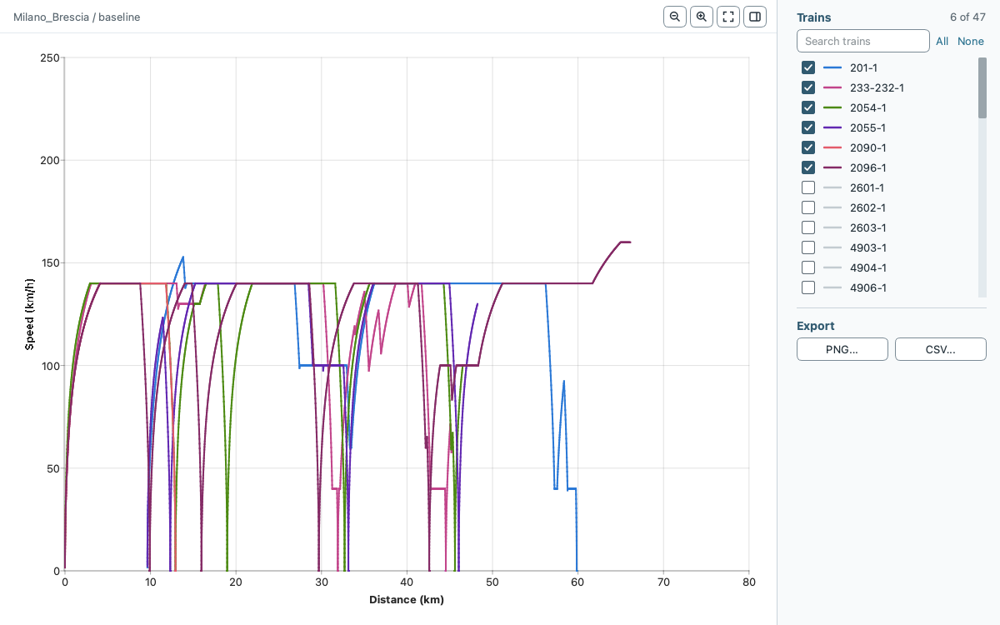

# Bundled cases

The application packages contain six bundled cases, and the releases page offers each as an `.egscene` file. This page lists them with their size.

| Case | Release file | Tracks | Stations | Services | Note |
| --- | --- | ---: | ---: | ---: | --- |
| Netherlands | `Netherlands.egscene` | 268 | 41 | 8 | Every service ends at its last stop: the train leaves the network after its dwell. |
| Paimpol | `Paimpol.egscene` | 6 | 10 | 2 | Paimpol, France. Includes passenger data. |
| Copenhagen | `Copenhagen.egscene` | 168 | 94 | 24 | Copenhagen, Denmark. |
| Milano_Brescia | `Milano_Brescia.egscene` | 38 | 29 | 62 | Milan to Brescia, Italy. The gradients are stored as rise per length; the dataset readme gives them in per mille. |
| Assignment Gvc-Gdg-Ut | `Assignment_Gvc_Gdg_Ut.egscene` | 2 | 3 | 4 | Synthetic two-track fixture. Sources and terms in `DATA.md`. |
| Amsterdam_Hilversum_Student | `Amsterdam_Hilversum_Student.egscene` | 268 | 41 | 1 | Fictional teaching timetable on the Netherlands network, added after release v1.0.2. See the [student case guide](amsterdam-hilversum-student-case.md). |

The counts are the numbers of entries in `infrastructure.json` (tracks), `stations.json` (stations) and `services.json` (services), so they can differ from the number of trains in a result window. The case folders are in `EGTRAIN/QEGTRAIN/Scenes` in the repository and inside the application packages.

The source, changes and terms of each bundled case are in `DATA.md` at the top of the [repository](https://github.com/Ancientkingg/EGTRAIN).

The Speed / distance result window of Milano_Brescia (baseline) after a run, with six of its 47 trains shown.
