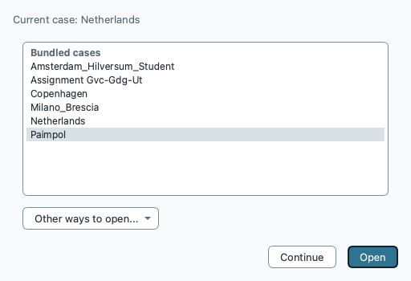
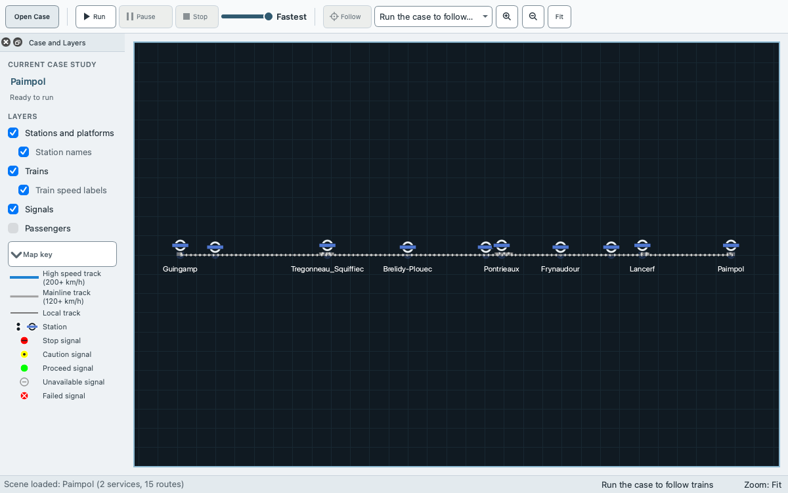
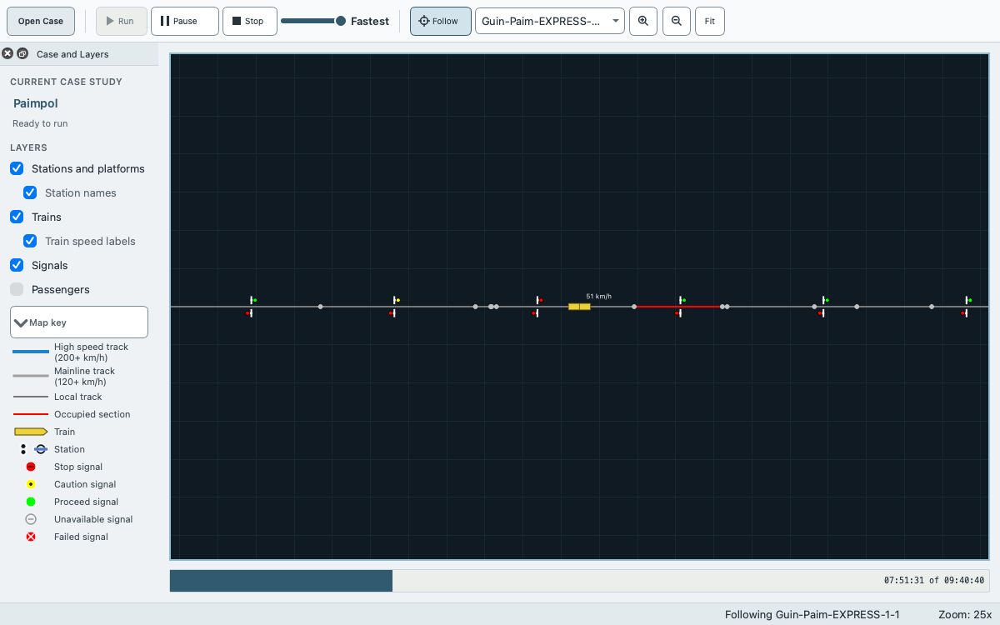

# Getting started

This page takes you from a download to a finished run of the Paimpol case study, its results and two exported files. Paimpol is a small line with 6 tracks, 10 stations and 2 services, and it runs in seconds. You need only the downloaded program. You do not need the source code, a build or the command line.

The steps use the labels of the window. A label such as **Run** is a menu entry or a button, and a name such as `Paimpol` is a case. On macOS the key Ctrl in a shortcut is the Command key, and [Keyboard shortcuts](keyboard-shortcuts.md) lists every shortcut.

This walk was done on macOS. On Linux (an Ubuntu 24.04 desktop in a container, 2026-10-17) the first steps were repeated with the program built from source: opening Paimpol, the dialog **Run simulation**, the run, the results table and the output folder `~/.local/share/EGTRAIN/EGTRAIN/Output/Paimpol` matched this page, with Ctrl as the shortcut key. The AppImage is started and walked through these steps by the Linux rehearsal job of each release run; its install step was not walked by hand. On Windows 11 (the release candidate of 2026-10-17, installed per user) the cases opened and ran as on this page, the dialog **Run simulation** and the results table matched it, and each case that was opened or run had its output folder under `%APPDATA%\EGTRAIN\EGTRAIN\Output`.

## Three things to keep apart

- **The case.** The input: the network, the rolling stock, the services and the scenario. Opening a case does not change it, and a run does not change it. Only your edits do, and only a save writes them.
- **Playback.** What you watch while a run is active: trains move on the network view as the simulation produces steps. A run that you stop leaves no results.
- **Results.** What a run that reached its end leaves in memory: the dock **Run Results**, the result windows, the replay row and the output files. Any edit of the case, a new case or another scenario discards them. Saving the case does not save them.

The [glossary](glossary.md) defines the other words of the program.

## 1. Install and start

Download the package for your system from the [releases page](https://github.com/Ancientkingg/EGTRAIN/releases). [Installing EGTRAIN](install.md) has the steps for each system, including what to do when macOS or Windows warns before the first start.

- macOS: open the disk image, drag `QEGTRAIN.app` onto `Applications`, and start it from there. A copy kept in a folder inside your home folder can make macOS ask for access to Desktop, Documents and Downloads at the first **File > Open Case Study...**: in column view the file dialog then lists your home folder. If macOS has not asked for access to Documents yet, it can ask at the first export or save, because an export dialog starts in your Documents folder, as does a save dialog for an example case or a new case. That dialog does not respond until you answer.
- Windows: run `EGTRAIN-Setup-<version>-x64.exe` and start **EGTRAIN** from the Start Menu, or unzip `EGTRAIN-Portable-<version>-x64.zip` into a new, empty folder and run `QEGTRAIN.exe`.
- Linux: make the AppImage executable and run it. It needs glibc 2.38 or later, as on Ubuntu 24.04. On a minimal system that reports a missing library such as `libGL.so.1`, install `libgl1`, `libopengl0`, `libegl1`, `libharfbuzz0b` and `libfontconfig1` first. The AppImage also needs the FUSE 2 library: when it stops with `AppImages require FUSE to run.`, install `libfuse2t64`, or start it with `./QEGTRAIN-linux-x86_64.AppImage --appimage-extract-and-run`.

The packages contain the example cases, so you need no separate case file. If you prefer a file, download `Paimpol.egscene` from the same page.

## 2. The first start

EGTRAIN asks its questions in this order. Some appear only once.

1. **Recover Unsaved Work** appears only when an earlier session ended with unsaved edits. A first start has nothing to recover. After **Recover**, the list of the next step does not appear; open Paimpol with **Open Case** in the toolbar. See [If something goes wrong](#if-something-goes-wrong).
2. **Open a Case** opens over the case that EGTRAIN has loaded already (Netherlands, unless you chose another). The list has the group **Bundled cases**, which holds the example cases of the package, and the group **Recent cases**, which lists other cases you opened or saved before. Select `Paimpol` and click **Open**, or double-click it. A long name is shortened in the middle of its row; hold the pointer over the row to see the whole name and the path. The first entry of the list is already selected when the window opens, so select `Paimpol` itself before you click **Open**. **Continue** keeps the loaded case.

   
3. When the earlier steps are done, and **Open a Case** has closed if it appeared, the first start only may also ask **Check for EGTRAIN updates automatically?** Either answer works: **Check Automatically** or **Don't Check Automatically**. **Help** changes the choice later. See [Updating EGTRAIN](updates.md).

The toolbar button **Open Case** shows **Open a Case** again whenever you want to open another case. If you started EGTRAIN by opening a `.egscene` file, or if the list does not show Paimpol, use **File > Open Case Study...** and select `Paimpol.egscene` instead. The file dialog starts in the folder above the open case, and on macOS, with no case open, in the `Scenes` folder of the app. [Opening an `.egscene` case study](opening-a-case-study.md) describes that.

## 3. Look at the case

When Paimpol has loaded:

- The window title reads `EGTRAIN - Paimpol`, and the status bar reads `Opened Paimpol`.
- The network view shows the tracks and stations. Turn the mouse wheel to zoom around the pointer and drag to move the view. On a trackpad, two fingers move the view and a pinch zooms. Click **Fit** (Ctrl+0) in the toolbar to see the whole network again. A click on a track, station or signal opens an information panel for it. To find a station, signal or train by name, choose **Edit > Find...** (Ctrl+F).
- The dock **Case and Layers** on the left names the case. When validation finds an error, the line under the name shows the first error and **Run** is disabled. The check boxes under **Layers** switch parts of the picture on and off: **Stations and platforms**, **Station names**, **Trains**, **Train speed labels**, **Signals** and **Passengers**. **View > Map Key** explains the symbols. **Passengers** is off at the first start and is the same switch as **View > Passengers**. Turning it on shows the passenger markers and counters on the platform bars from the next run, and turning it off hides them at once. The platform bars belong to the stations: they show whenever you zoom in on a station, with or without passengers. A case without passengers draws no passenger markers and shows both controls off and disabled; the choice comes back in a case with passengers. `-pax 1` ([the option](command-line.md#options)) starts with passengers on, and the program remembers the last choice.
- The toolbar holds **Open Case**, **Run**, **Pause**, **Stop**, a speed slider with the current speed next to it, **Follow** with the list of trains, the zoom buttons and **Fit**.

The editors, **Scene Validation**, **Loaded Data** and **Log** are hidden when the window opens. The menu **Editors** opens the editors, and the menu **View** opens the other docks.

### Validation

EGTRAIN checks the case when it opens, after every edit and before every run. An error stops a run, and a warning does not. Paimpol has no errors. It has a few hundred warnings, nearly all with the code `scene.passenger.legs.empty` (a passenger journey without route-choice legs), and they do not matter for this walk.

To see the findings, choose **View > Scene Validation** (Ctrl+Shift+V). The table lists each finding with its **Severity**, **Code**, **Message**, **File**, **Path** and **Fix**; **Code**, **File** and **Path** are in the tooltip of a row and show as columns with **View > Advanced Details**. The status bar names validation only when it finds an error (`Cannot run: 1 error`). **View > Advanced Details** adds the counts, as in `2 warnings`, and the dock **Loaded Data**.

## 4. Run the simulation

1. Click **Run** in the toolbar, or choose **Simulation > Run** (Ctrl+R) or **File > Run Scene**. The three do the same.
2. The dialog **Run simulation** reviews the run before it starts. Under the name of the case and the scenario (`Paimpol / baseline`) it shows **Trains** (2: both services enter during the run), **Start time** (07:10:40) and **Duration** (`2:30:00, until 09:40:40`). **Incidents** shows only when the scenario has any, and a line under the facts shows only when something needs your attention, for example `No selected trains start in this period.` **Run details** shows more.

   
3. Click **Run simulation**. **Cancel** returns to the window without a run.

While the run is active:

- The progress bar under the network shows the clock time and the end time, such as `07:51:31 of 09:40:40`; its tooltip gives the step (`Step n of m`). The status bar reads `Running`, and the trains move on the network view. On this long line they are small at the full view: choose a train in the list next to **Follow**, or zoom in on a station, to see one. The track of the section that a train occupies is red. From a zoom of 3x the speed of each train is written beside it, and that of a selected or followed train at any zoom.

  
- Move the speed slider to the right to play faster or to the left to play slower. It starts at the fastest setting. **Pause** (Ctrl+.) stops the clock, and the button then reads **Resume**. **Stop** (Ctrl+Esc) ends the run, and a stopped run leaves no results.
- To keep a train in view, choose it in the list next to **Follow** and click **Follow**. Zooming and dragging still work.
- The menu **Editors** still opens every editor, but the contents of **Services**, **Passengers**, **Infrastructure** and **Scenarios** are disabled, and so are **Edit > Undo**, **Edit > Redo** and **File > Set Output Folder...**. The editors **Case Settings**, **Rolling Stock Units** and **Compositions** stay usable, but an edit there discards the results of that run, so wait for the run to end first.

At the fastest speed the run of Paimpol takes seconds. When it has ended, the status bar reads `Simulation complete`, the dock **Run Results** opens, and the **Replay** row appears under the network. Follow switches off when the followed train leaves the network, so in Paimpol it is usually off before the end.

## 5. Replay the run

The **Replay** row has the icon buttons **Start**, **Play** and **End**, a slider and the clock time of the shown frame, such as `07:31:10`. Moving the slider or clicking **Start** or **End** shows the network as it was at that time, and **Play** advances one simulated second for each second of real time. The row records one frame every 5 simulated seconds and shows the last frame at or before the chosen time. A run that is too large to keep whole loses its first part, and a line under the controls says which part the row holds. [How-to](how-to.md#replay-a-completed-run) has the details.

## 6. Read the results

The dock **Run Results** names the run in the lines at its top, for example `Run: Paimpol / baseline`, `Occurrences: 2/2 selected` and `Status: Completed`. When some ticked occurrences enter outside the run period, the line `Occurrences` also gives the number inside it, as in `Occurrences: 196/196 selected, 185 in the run period`; that number is the **Trains** of the dialog **Run simulation**. Its table has one row for each train and a last row, **Network total**. The trains of Paimpol are `Guin-Paim-ALL-STOPS-1-1` and `Guin-Paim-EXPRESS-1-1`. The columns are **Train**, **Operating code**, **Performance (%)**, **Maximum speed (km/h)**, **Start time (hh:mm:ss)**, **End time (hh:mm:ss)**, **Travel time (h:mm:ss)** and four energy columns in kWh.

To open a result window, click **Open result view...** in the dock and choose an entry, or use the menu **Diagrams**. Two to try first:

- **Speed / distance** (**Diagrams > Speed / distance**) plots the speed of each train against the distance it covered. Hover a line to read a value, click a line to select its train, and drag a rectangle to zoom. [Inspecting diagrams](diagram-navigation.md) describes the controls.
- **Timetable** (**Diagrams > Timetable**) lists each stop of each train with its planned and simulated arrival and departure and the delays.

The other entries are listed in [How-to](how-to.md#results-and-exports). The entries stay disabled until a run has ended.

## 7. Export one CSV and one PNG

1. In the dock **Run Results**, click **Export CSV...**. The dialog **Export Data** suggests the name `run_summary.csv`. Choose a folder of your own and save. The file has one row for each train and the row **Network total**.
2. Click **Export PNG...**. The dialog **Export Table** suggests `run_summary.png`. Save it. The picture shows the whole table, with every row and column, also those the dock has to scroll to.

Each chart window has **CSV...** and **PNG...** in its panel, and the window **Timetable** has **Export CSV...** and **Export PNG...**, for the data and the picture of that window. **Delay analysis**, **Capacity** and **Capacity by area** have only **Export CSV...**. Every export writes a second file with the same name plus `.provenance.json`, which records the run that produced it. Keep the two files together.

An export dialog starts in your Documents folder, or in your home folder when there is none. Exports are not written to the output folder below.

## 8. Where the other output goes

A run also writes text files, such as the energy files and the delay statistics. They go to the output folder `<application data folder>/Output/Paimpol`:

| System | Application data folder | Checked |
| --- | --- | --- |
| macOS | `~/Library/Application Support/EGTRAIN/EGTRAIN` | yes |
| Windows | `%APPDATA%\EGTRAIN\EGTRAIN` | yes, on Windows 11 |
| Linux | `~/.local/share/EGTRAIN/EGTRAIN` | yes, on Ubuntu 24.04 |

The Windows entry follows the rule of Qt for the application data folder. **File > Set Output Folder...** chooses another folder for the following runs of the session. [Command-line options](command-line.md#output-folder) explain the rule and `QEGTRAIN_OUTPUT_DIR`, and [Run output](run-output.md) lists the files.

## If something goes wrong

- **Run is disabled.** No case is open, a run is active, or validation reports an error. Open **View > Scene Validation** and read the first error. [How-to](how-to.md#why-a-command-is-disabled) lists the reasons for the other disabled commands.
- **A message refuses the run.** It names the problem, for example `Cannot run: 2 errors` with `Fix the errors in Scene Validation.`, or `Select at least one occurrence on the Run occurrences tab of Services.` On Windows and Linux it is titled **Cannot Run Scene**.
- **Cannot Open Case Study.** The file is damaged or is not an EGTRAIN case. Keep the message, and download the file again. [Opening an `.egscene` case study](opening-a-case-study.md#scenes-that-do-not-open) lists the other dialogs for a scene that does not open.
- **Unsaved Scene.** Before EGTRAIN replaces a case that has unsaved edits, it asks **Save**, **Discard** or **Cancel**. On macOS this is a sheet without a title, and the buttons are **Save**, **Cancel** and **Don't Save**. **Cancel** keeps the case and its edits. For an installed example case, **Save** asks for a new `.egscene` file and never writes into the installation.
- **Recover Unsaved Work.** While a case has unsaved edits, EGTRAIN keeps a recovery copy and updates it about every 30 seconds. While an entry of the case is incomplete, for example a new service without a composition, no copy is written and the status bar says `Autosave unavailable: ...`. If EGTRAIN closed before you saved, the next start offers **Recover**, **Discard** and **Decide Later**. **Recover** opens the copy as an unsaved case. Choose **File > Save Case Study As...** to keep it.
- **Undo.** The **Edit** menu has **Undo** and **Redo** for edits of the case.
- **Nothing happened after a run.** If you stopped the run, there are no results. Run it again and let it end.

## Known limits

- No supplied case study has signals. Each has one signalling area at level 0 over the whole network, so none of them shows the separation of trains by signals. See [The committed scenes](signalling-levels.md#the-committed-scenes).
- The case `Assignment_Gvc_Gdg_Ut` is a synthetic fixture, not a case with source-backed railway data. See [Assignment workflow](assignment-workflow.md).
- The Windows files are not code signed, and the macOS app is not notarized unless the release notes say so. [Installing EGTRAIN](install.md) says what the first start shows.
- EGTRAIN keeps the newest 20 recovery copies of unsaved work.

## Next

This manual is also in EGTRAIN: **Help > EGTRAIN Manual** opens it with its contents and search, and F1 opens the section about the window you are in when the manual has one, otherwise its start page. A build without the manual opens the manual on the project website instead.

- [How-to](how-to.md): recipes for opening and saving, editing a timetable, scenarios and baselines, canvas navigation, results and legacy cases.
- [Opening an `.egscene` case study](opening-a-case-study.md): bundles, version checks and opening by double-click.
- [Editing and validating a case](editing-a-case.md), [Scenarios and the student loop](scenarios.md) and the [scene schema](scene-schema.md): the editors, the scenarios and the scene files.
- [Glossary](glossary.md).
