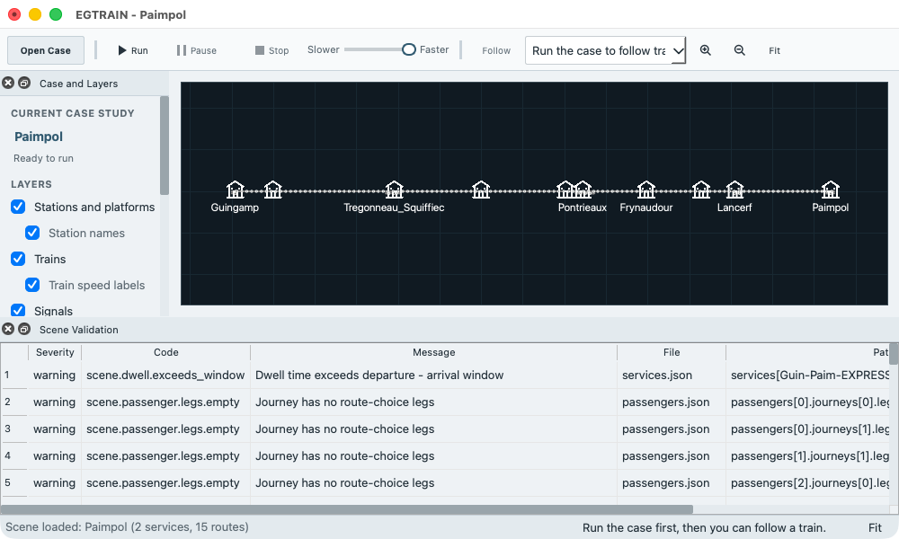
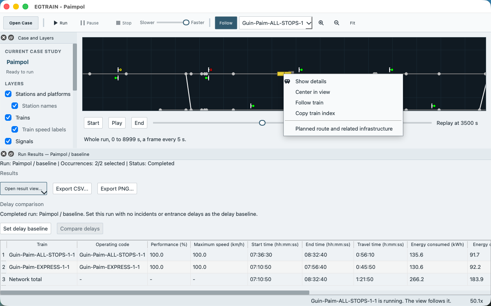

# How-to

Short recipes for the common tasks. Each says what you need, what to do and what you should see. [Getting started](getting-started.md) is the walk from a download to a first run, and the [glossary](glossary.md) defines the words. On macOS the key Ctrl in a shortcut is the Command key.

- [Open a case](#open-a-case)
- [Copy and save a case](#copy-and-save-a-case)
- [Fix validation errors](#fix-validation-errors)
- [Run a case](#run-a-case)
- [Answer the unsaved changes question](#answer-the-unsaved-changes-question)
- [Edit a timetable stop](#edit-a-timetable-stop)
- [Edit rolling stock](#edit-rolling-stock)
- [Compare a scenario with a baseline](#compare-a-scenario-with-a-baseline)
- [Move around the network view and follow a train](#move-around-the-network-view-and-follow-a-train)
- [Replay a completed run](#replay-a-completed-run)
- [Results and exports](#results-and-exports)
- [Convert a legacy case and write legacy files](#convert-a-legacy-case-and-write-legacy-files)
- [Close, start a new case or open another during a run](#close-start-a-new-case-or-open-another-during-a-run)
- [Why a command is disabled](#why-a-command-is-disabled)

## Open a case

You need a case: an example case of the package, an `.egscene` file or a scene folder.

Use one of these:

- Click **Open Case** in the toolbar. In **Open a Case**, select an entry under **Bundled cases** or **Recent cases** and click **Open**. A long case name is shortened in the middle of the row; hold the pointer over the row to see the whole name and the path. **Other ways to open...** offers **New Case Study...**, **Open Scene Folder...** and **Import Legacy Case...**.
- Choose **File > Open Case Study...** (Ctrl+O) and select an `.egscene` file.
- Choose **File > Open Scene Folder...** and select a folder that holds `scene.json`.
- Choose **File > Recent Scenes**. It lists the last 8 cases you opened or saved, each under the name that **Open a Case** shows (a saved `.egscene` file without its extension). The menu checks the files each time it opens. An entry whose file is gone reads `Unavailable:` and is disabled, and the menu is greyed out while the list is empty.
- Drag one `.egscene` file onto the window. A folder or several files are refused with `Drop rejected: <reason>. Scene unchanged.` in the status bar.
- On Windows and macOS, double-click an `.egscene` file ([Open by double-click](opening-a-case-study.md#open-by-double-click)).
- From a terminal, `QEGTRAIN --scene path/to/case.egscene` opens a bundle or a scene folder, and `QEGTRAIN path/to/case.egscene` opens a bundle ([command-line options](command-line.md)).

The dialogs of **Open Case Study...** and **Open Scene Folder...** start in the folder above the open case. With no case open, they start in the `Scenes` folder of the app on macOS, and in your home folder on other systems.

You should see the window title `EGTRAIN - <case name>`, the network in the view and the status bar `Scene loaded: <case name> (<n> services, <m> routes)`. Opening a case does not run it and does not change the file.

If the case does not open, a dialog says why: **Cannot Open Case Study**, **Older Scene Not Supported** or **Newer Scene**. [Opening an `.egscene` case study](opening-a-case-study.md) explains each. While the current case has unsaved edits, see [the unsaved changes question](#answer-the-unsaved-changes-question).

Normal mode keeps the network view and the editors uncluttered. **View > Advanced / Developer details** switches to advanced mode, which raises the dock **Loaded Data** automatically after a case opens and shows the full validation counts, the non-blocking warnings and the technical inventories. In normal mode **View > Loaded Data** and **View > Scene Validation** still open those docks. The choice changes what is shown, not what a run does.

## Copy and save a case

An example case of the package is read-only in practice: EGTRAIN never saves into the installation. Make your own copy before you edit.

1. Choose **File > Save Case Study As...**.
2. Choose a folder of your own and a file name. EGTRAIN adds `.egscene` when you leave it off. The dialog starts in the folder of your open case, or in your Documents folder for an example case.
3. Save.

You should see `Scene saved` in the status bar. Your file is now the open case, and it appears in **File > Recent Scenes**. The original is unchanged. The file holds the inputs of the case and no results, replay or delay baseline.

Other ways to save:

- **File > Save Scene** (Ctrl+S) writes the case back to the bundle or scene folder it came from. For an example case of the package, and for a new case that has no file yet, it asks for a new `.egscene` file instead, as **Save Case Study As...** does, and Cancel keeps the edit. A scene folder outside the installation, such as one in a source checkout, is saved in place.
- **File > Save Scene As Folder...** writes the scene as a folder of JSON files, which you can edit by hand. If the folder you choose is not empty and holds no `scene.json`, EGTRAIN asks `Save scene files there?`. A folder that already holds a `scene.json` is written over without a question; other files in it are kept.
- A destination inside the installation is refused with **Cannot Save Scene**: `Installed example scenes cannot be overwritten. Choose a location outside the EGTRAIN installation.`

To check a saved case, open it again from **File > Recent Scenes**. The three save commands are enabled whenever a case is open, also during a run.

## Run a case

You need an open case with no validation error. [Getting started](getting-started.md#4-run-the-simulation) walks through a first run.

1. Click **Run** in the toolbar, or choose **Simulation > Run** (Ctrl+R).
2. Read the dialog **Run simulation** and click **Run simulation**. **Cancel** returns to the window without a run.

The trains move on the network view, and the status bar reads `Running scene: <case name>`. **Pause** and **Stop** are in the toolbar.

The command **Simulation > Start Time** opens a dialog for the start clock, but a run takes its start clock from the base time of the case, so the command does not change the run.

## Fix validation errors

You need an open case. EGTRAIN checks it when it opens, after every edit and before every run. An error disables **Run** and a warning does not.

1. Read the line under **Current case study** in the dock **Case and Layers**. It says **Ready to run**, or it shows the first error.
2. Choose **View > Scene Validation** (Ctrl+Shift+V). The table lists the findings, errors first, with **Severity**, **Code**, **Message**, **File**, **Path** and **Suggested Fix**.

   
3. Fix the first error in the editor that matches its **File** and **Path** (menu **Editors**), and read the table again. It updates after each edit.
4. Repeat until no error is left. **Run** is then enabled.

You can save a case that has errors. Warnings do not stop a run, but read them: the dialog **Run simulation** repeats the one about route sections that have no signalling level. Examples of errors and their usual fixes:

- A service names a composition or a route that does not exist. Choose an existing one in **Services**, or add the missing record.
- A stop names a platform that the route does not reach, or the stops are out of route order. Correct the stop on the tab **Timetable** of **Services**.
- A rolling stock unit has no traction rows, or its rows overlap, are out of order or have a lower speed that is not below the upper speed. Correct them in **Rolling stock units**.

**Run** stays disabled while any error remains. From a terminal, `scene_tool validate --runnable path/to/scene` prints the same findings ([scene_tool](command-line.md#scene_tool)). [Scene editor flow](../architecture/scene-editor-flow.md#window-flow) describes the validation layers.

## Answer the unsaved changes question

After an edit the case is unsaved. EGTRAIN then asks (`The current scene has unsaved changes.`) before it replaces the case, which happens when you open another case, choose **New Case Study...**, load a legacy case or close the window. On Windows and Linux the box is titled **Unsaved Scene** and offers **Save**, **Discard** and **Cancel**. On macOS it is a sheet without a title that offers **Save**, **Cancel** and **Don't Save**, which does what **Discard** does.

- **Save** saves the case first. For an example case or a new case it asks for a new `.egscene` file, and if you cancel that dialog, the open or close is cancelled too.
- **Discard** (**Don't Save** on macOS) drops the edits.
- **Cancel** keeps the case and its edits. After an open, the status bar reads `Open canceled. Current scene retained.`

If EGTRAIN closes without an answer, for example after a crash, it offers the edits again at the next start in **Recover Unsaved Work** (see [Getting started](getting-started.md#if-something-goes-wrong)). **Edit > Undo** and **Edit > Redo** step through the edits of the session.

## Edit a timetable stop

You need an open case that you have copied ([Copy and save a case](#copy-and-save-a-case)) and no active run. The contents of the dock **Services** are disabled during a run; the menu entry still opens it.

1. Choose **Editors > Services** and select the service in the list **Services**. The dock has the tabs **Service**, **Timetable** and **Run occurrences**. Open the tab **Timetable**.
2. In the table of stops, click the row of the stop. The dialog **Edit timetable stop** opens with the station, the platform, **Minimum dwell (s)**, **Planned arrival** and **Planned departure**.
3. Change the field. **Planned time display** switches the dialog between **Elapsed offsets (s)** (seconds from the base time of the case) and **Clock time**. Blank means the time is absent, and `0` is the start of the simulation.
4. Click **OK** to apply the fields together, or **Cancel** to leave the stop as it was.

The buttons **Add Stop**, **Insert After Selected**, **Remove Stop**, **Move Up** and **Move Down** change the list of stops. After an edit the validation runs again, and the results, the replay and the delay baseline are discarded. Run again to see the effect. **Edit > Undo** reverts the edit. The rules for the times, the platforms and the insert positions are in [Edit and validate](scenes-and-application.md#edit-and-validate).

For the whole exercise of changing a copy, saving it, opening it again, validating it and running it while the original stays as it was, follow the [tutorial](tutorial-modify-a-case.md).

## Edit rolling stock

You need an open case that you have copied and no active run. The editors **Rolling stock units** and **Compositions** are not disabled during a run, but an edit there discards the results of that run.

1. Choose **Editors > Rolling stock units**. **Add Unit**, **Duplicate** and **Delete** change the list. Select a unit to edit its physical values and its traction rows (**Add Traction Row**, **Delete Traction Row**). **Plot input traction characteristic** plots the curve.
2. Choose **Editors > Compositions** to put units in order for a train: **Add Composition**, **Add Unit**, **Remove Unit**, **Move Up**, **Move Down**.
3. Choose the composition of a service in **Editors > Services**.

**Link parameter file...** and **Link traction file...** in the editor of a unit read the values of a unit from a text file. The links last for the session: **Unlink** removes one, and reopening or replacing the case clears them. [Review what loaded](scenes-and-application.md#review-what-loaded) gives the file formats and the rules for a changed file.

## Compare a scenario with a baseline

A scenario is a named set of incidents and entrance delays. **Set delay baseline** freezes a completed run without them, and **Compare delays** shows how much later or earlier each call of a run with them is. Any edit of the case clears the baseline, so build the scenario before you run the baseline.

1. Choose **Editors > Incidents**. The list **Scenarios** holds each scenario. Click **Blank**, or select a scenario and click **Duplicate**, to create the scenario to test.
2. In the incident editor of the dock, click **Add Incident** and fill its fields. For an entrance delay, open the tab **Entrance delays** and click **Add**. This adds a row for the first service that has a planned departure, at its first stop with one, with a delay of 0 s. With the row selected, change **Service**, **Occurrence**, **Station** and **Delay (s)**; the line in the list follows each change, and **Delay (s)** takes effect when you press Enter or leave the field.
3. Select the scenario without incidents and entrance delays (the example cases have one, `baseline`). Click **Run**, and **Run simulation**. When the run has ended, click **Set delay baseline** in the dock **Run Results**. The line under **Delay comparison** names the baseline.
4. Select the scenario with the incident in the list **Scenarios**. This keeps the baseline and discards the results. Run it.
5. Click **Compare delays**. The window **Delay analysis** opens on the tab **Against baseline**.

The two buttons say why they are disabled in their tooltips and in the line above them. **Set delay baseline** needs a completed run whose scenario has no incident and no entrance delay. **Compare delays** needs a baseline and a completed run whose scenario has at least one of them. The tab lists every reason when the baseline does not fit the run: the runs need different scenarios and the same scene revision, base time, duration, timestep and occurrences. [How delays are calculated](delay-analysis.md#delay-comparison-against-a-baseline) has the rules. [Scenario library and student loop](scenes-and-application.md#scenario-library-and-student-loop) describes the library. **Import JSON...** and **Export JSON...** in the dock move a single scenario between cases.

## Move around the network view and follow a train

- **Zoom.** Turn the mouse wheel to zoom around the pointer, or use the zoom buttons of the toolbar (Ctrl++ and Ctrl+-). On a trackpad, a pinch zooms. **Fit** (Ctrl+0) shows the whole network. A network that is fitted has no room to move, so zoom in first.
- **Pan.** Drag the view. On a trackpad, two fingers move it.
- **Select.** Click a track, connection, node, station, signal, train or passenger. The information panel for it opens and a light blue ring marks the item. Click an empty part of the view, or close the panel, to remove the ring.
- **Context menu.** Right-click an item. A train offers **Show details**, **Center in view**, **Follow train** and **Copy train index**. Most other items offer **Show details**, **Center in view** and a copy command. Right-click the empty view for **Fit whole network**, **Clear selection** and **Stop following train**.
- **Layers.** The check boxes in **Case and Layers** hide stations, station names, trains, speed labels, signals and passengers.
- **Follow.** Choose a train in the list next to **Follow** in the toolbar and click **Follow**. The view moves with the train, also while the run is paused. Click **Follow** again, or choose **Stop following train**, to stop.

**Follow** is disabled before a run and in a case without services, and its tooltip says why. A train that has not entered the network is listed with its scheduled entry time, for example `Rail-1 (scheduled 08:25:50)`, and Follow starts when it enters. The label at the right of the status bar says in one sentence whether the selected train is followed and why not. In a live run Follow switches off when the train leaves the network. In the replay of a completed run it stays on after the train has left, and it continues when you go back in time. [Scenario library and student loop](scenes-and-application.md#scenario-library-and-student-loop) describes the camera in detail. For the result windows, see [Inspecting diagrams](../ui/diagram-navigation.md).

## Replay a completed run

You need a run that reached its end. A stopped or failed run has no replay, and a stopped run keeps no results either.

1. When the run has ended, the **Replay** row appears under the network. Click **Start**, **Play** or **End**, or move the slider. The arrow keys and the mouse wheel move the slider too.
2. Each selection shows the last recorded frame at or before the chosen time, not an interpolated position. The label beside the slider reads, for example, `Replay at 1230 s`. **Play** advances one simulated second for each second of real time, and the button then reads **Pause**.
3. The text under the controls says which part of the run the replay holds, and that a frame is recorded every 5 simulated seconds, for example `Whole run, 0 to 7999 s, a frame every 5 s.`

   

The replay has 128 MiB of memory. A run that is larger loses its oldest frames. The text then says from which time the replay starts, for example `Starts at 10:00:20 (7220 s), ends at 7999 s, a frame every 5 s. The earlier part was not kept because the run is larger than the replay memory (128 MiB).` The slider covers only the kept part, and **Start** goes to its first time. The tooltip of **Start** says so. If not even one moment fits, the row says `No replay` with the reason, and the slider and **Play** are disabled.

Train, station and signal selections stay across seeks. A train that has no position at the selected time is not drawn. Passenger journey details are not available in a replay, but the counts and statuses are. A new run, an edit of the case or another scenario clears the replay and returns the view to the preview.

## Results and exports

You need a run that reached its end. Until then the result commands are disabled and read `Run a simulation to enable this diagram`.

1. The dock **Run Results** opens when the run ends. If you closed it, choose **View > Run Results**.
2. Click **Open result view...** and choose an entry, or use the menu **Diagrams**. Both menus use the same names: Timetable, Timetable graph, Delays, Delay analysis, Speed / distance, Speed / time, Time / distance, Tractive effort / distance, Train paths, Blocking time, Capacity and Capacity by area. An entry in **Diagrams** that asks for more input ends in an ellipsis.
3. **Timetable graph** and **Train paths** first ask for a reference route, and **Blocking time** asks for its scope. **Capacity** needs at least two trains that share the entry of a section: choose a route and a first block that both trains pass.
4. In a chart window, the button **Trains** filters the trains, **Reset zoom** returns to the full chart, and **Export CSV...** and **Export PNG...** save the data and the picture of the visible trains. Hover, click, zoom and pan are described in [Inspecting diagrams](../ui/diagram-navigation.md).

The buttons **Export CSV...** and **Export PNG...** in the dock save the summary table as `run_summary.csv` and `run_summary.png`. Each export asks for a path, adds the extension when you leave it off and writes a second file, `<name>.provenance.json`, that records the run. Exports are not written to the output folder, and they are not part of the case. An export dialog starts in your Documents folder, or in your home folder when there is none. A window keeps the run it was opened for, so a later run does not change it. If the write fails, the message **Export failed** names the path.

Delay figures are explained in [How delays are calculated](delay-analysis.md), capacity in [How capacity is analysed](capacity-analysis.md) and the text files of a run in [Run output](run-output.md).

## Convert a legacy case and write legacy files

A legacy case is the input folder of earlier versions. EGTRAIN converts it into a new scene folder and leaves the source unchanged.

1. Choose **File > Load Legacy Case...**, or **Other ways to open... > Import Legacy Case...** in **Open a Case**. The chooser in **Open a Case** first asks `Choose the original text-input folder, then a folder for the converted scene. Continue?` The menu entry goes straight to the folder dialogs.
2. Select the legacy case folder in **Select Legacy Case Folder**, then a destination in **Select Scene Destination**. The destination must already exist, so create an empty folder for it first (the folder dialog has a button for a new folder); a name that does not exist gives `Directory not found`. It must be separate from the source and outside it, or **Cannot Import Legacy Case** says so. If the open case has unsaved edits, EGTRAIN asks about them after you have chosen both folders and before it imports.
3. Read **Legacy Import Diagnostics**, which counts errors and warnings and shows the first findings. The converted scene then opens. A legacy case without a usable `InitialParameters` file, such as one that `scene_tool export` wrote, has no base time and no duration: the scene reports two validation errors and cannot run until you set both in **Editors > Case Settings**. The details are in `import_report` in `scene.json`, and the dock **Loaded Data** shows the counts.

From a terminal:

```bash
scene_tool import path/to/legacy-case path/to/new-scene SceneName
scene_tool validate path/to/new-scene
```

The window cannot write legacy files. `scene_tool export path/to/scene path/to/legacy-output` writes them for another tool, and edits to those files do not flow back into the scene. [Convert a legacy case](scenes-and-application.md#convert-a-legacy-case) lists what the conversion preserves, and the [migration matrix](v1-scene-migration-matrix.md) says what each legacy file becomes.

## Close, start a new case or open another during a run

Closing the window, **New Case Study...**, the open commands and **Load Legacy Case...** first ask for the unsaved changes question if the case has edits. They then ask the running simulation to stop. The status bar shows `Stopping simulation...` and the window stays usable. The command goes on when the run has stopped, and the current case is replaced only then, so an open that fails leaves it in place. A stopped run leaves no results.

## Why a command is disabled

| Command | It is disabled when | What to do |
| --- | --- | --- |
| **Run** (toolbar), **Simulation > Run**, **File > Run Scene** | No case is open, a run is active, or validation reports an error | Read the first error in **View > Scene Validation** ([fix validation errors](#fix-validation-errors)) or wait for the run |
| **Pause**, **Stop** | No run is active, or the run is already stopping | Start a run, or wait for the run to stop |
| **File > Save Scene**, **Save Case Study As...**, **Save Scene As Folder...** | No case is open | Open or create a case. A normal start always has one open |
| **File > Set Output Folder...** | A run is active | Wait for the run to end. The folder applies from the next run |
| The contents of the editors **Services**, **Passengers**, **Infrastructure** and **Incidents** (the menu **Editors** still opens them) | A run uses the case | Stop the run or wait. **Case Settings**, **Rolling stock units** and **Compositions** stay usable during a run, and an edit there discards the results of that run |
| **Edit > Undo**, **Edit > Redo** | A run uses the case, or there is nothing to undo or redo | Stop the run or wait |
| **Diagrams** entries, **Open result view...**, **Export CSV...**, **Export PNG...** in **Run Results** | No run has reached its end since the last edit | Run again. A stopped run, an edit, a new case and another scenario all discard results |
| **Set delay baseline** | There is no completed run, or its scenario has an incident or an entrance delay | [Compare a scenario with a baseline](#compare-a-scenario-with-a-baseline) |
| **Compare delays** | There is no baseline, or the completed run has neither an incident nor an entrance delay | Same |
| **Follow** | No run has started, or the case has no services | Run the case and choose a train |

When **Run** is enabled but **Cannot Run Scene** appears, the message names the problem: validation errors, or no selected service occurrence. In the tab **Run occurrences** of **Services**, tick **Include** for at least one occurrence.
