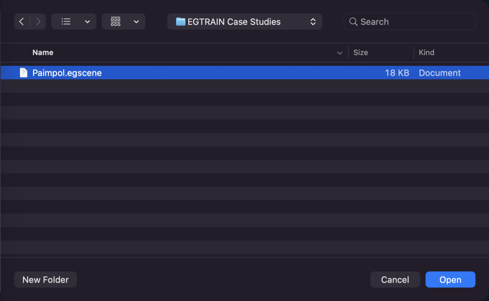
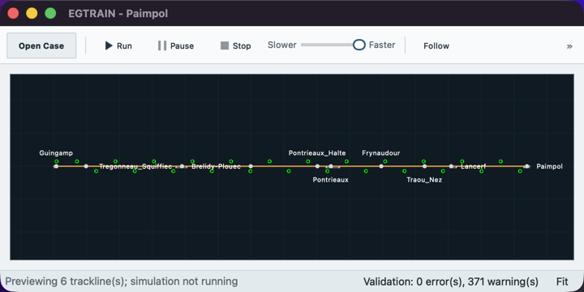

# Opening an `.egscene` case study

An `.egscene` file contains one canonical case study. It is a ZIP archive with
the same JSON data that EGTRAIN loads from a V1 scene directory.

## Open and run

1. Download the case-study `.egscene` file from the
   [EGTRAIN releases page](https://github.com/Ancientkingg/EGTRAIN/releases).
2. In EGTRAIN, choose **File > Open Case Study...** and select the file. On
   Windows and macOS you can instead
   [double-click the file](#open-by-double-click).

   

3. Review any validation diagnostics shown by the application. The loaded
   network appears in the main window before the simulation starts.

   

4. Choose **Run** when the case study is ready.

Opening a bundle does not run it or modify the downloaded file. Use
**File > Save Case Study As...** to create a new `.egscene` after editing the scene.

When you open a scene in the EGTRAIN window, EGTRAIN checks its version before
it loads the scene. The check never changes the file you opened. Three dialogs
report a scene that does not open:

- **Older Scene Not Supported**: the scene reports a version older than any
  EGTRAIN can read, or it has the draft layout. No older version can be
  upgraded today. The message names the version numbers of the scene and the
  EGTRAIN version that saved it, when the scene records that. Download the
  current case study from the releases page.
- **Newer Scene**: the scene was saved with a newer EGTRAIN. Choose
  **Check for Updates...** to look for the newer release.
- **Cannot Open Case Study**: the version cannot be read, the file is not a
  valid scene or bundle, or loading the scene reports errors. The message gives
  the file name and says that the file is damaged or is not an EGTRAIN case
  study, and the first problem follows it; keep it. The same message appears
  when EGTRAIN starts with that file.

Scenes written by builds before 2026-08-08 use an older layout under the same
version number. EGTRAIN recognises that draft layout, reports it in the
**Older Scene Not Supported** dialog and does not open it. Use the current case
studies, or convert the original legacy input folder again with **File > Load
Legacy Case...**.

See the [Compatibility boundary](../architecture/scene-model.md#compatibility-boundary)
for the full list of which scenes open.

If EGTRAIN rejects a downloaded file, keep the diagnostic message and download
the file again. The reader rejects truncated archives, unknown files, unsafe
paths, duplicate entries, and files that exceed the documented bundle limits.

## Open by double-click

On Windows and macOS, a double-click on an `.egscene` file in Explorer or Finder
opens the case study in EGTRAIN. The file opens as it does with **File > Open
Case Study...**: EGTRAIN checks the version in the same way and adds the case
study to **File > Recent Scenes** once it has opened. It does not run the case
study. The path may contain spaces and letters outside ASCII. Open one file at a
time.

**EGTRAIN is closed.** EGTRAIN starts with the case study open and does not
show the **Open a Case** window. If the file does not open, EGTRAIN says why and
starts with its default case. On Windows a message titled **Cannot Open Case
Study** names the problem, and the **Open a Case** window follows.

**EGTRAIN is already open.** The file opens in the window that is open, and the
window comes to the front. No second window starts. First, EGTRAIN deals with
what is in the way:

- With unsaved changes, EGTRAIN asks **Unsaved Scene** before it opens the file.
  **Save** saves the open case and **Discard** drops the changes, and the file
  opens after either. **Cancel** keeps the open case and its changes and does not
  open the file; the status bar then reads `Open canceled. Current scene
  retained.`
- A simulation that is running stops before the file opens.
- If the **Open a Case** window is open, it closes. If another dialog is open,
  such as a question at the first start, the file waits until you close it.
- If the file does not open, EGTRAIN shows the same message as **File > Open Case
  Study...** and the case in the window stays as it is.

### Windows

The installer registers `.egscene` for your Windows user, with the installed
`QEGTRAIN.exe` as the program that opens the file. Explorer then shows these
files as `EGTRAIN case study` with the EGTRAIN icon. Setup needs no
administrator rights and registers no other file type, so `.zip` files are
untouched. If you chose another program for `.egscene` files with **Open with**,
Windows keeps your choice until you choose EGTRAIN there.

When EGTRAIN is open, Explorer starts `QEGTRAIN.exe` again for a moment. That
program hands the file to the open window and ends. Only a window of the same
copy takes the file: a copy of EGTRAIN in another folder opens it in a window of
its own. The [command-line guide](command-line.md#startup-of-the-window) has the
rules.

Uninstalling EGTRAIN removes the registration that Setup made and leaves your
`.egscene` files alone. A double-click then no longer opens EGTRAIN.

The portable archive registers nothing, not even when you run it, so a
double-click does not start a portable copy. In a portable copy, open a case
study with **File > Open Case Study...**, drag the file onto the window, or give
the file name to `QEGTRAIN.exe` on the command line. If an installed copy exists
as well, a double-click starts that one, also while the portable copy is open.

### macOS

The app declares `.egscene` as the file type `EGTRAIN Case Study`, and no other
type. Copy `QEGTRAIN.app` out of the disk image to the Applications folder, as
the [README](../../README.md#macos-disk-image) describes, and open it from
there. The first start of an ad hoc signed app needs the steps that the README
describes.

Once macOS has registered the app, a double-click on a `.egscene` file opens it
in EGTRAIN, and **File > Get Info** in Finder shows the **Kind**
`EGTRAIN Case Study`. If EGTRAIN is open, Finder gives the file to that EGTRAIN
and no second copy starts. If a file opens in another program, or in none, take
it yourself:

- Control-click the file, choose **Open With**, and choose `QEGTRAIN`.
- To open every `.egscene` file in EGTRAIN, select a file and choose **File >
  Get Info**. Under **Open with**, choose `QEGTRAIN` and click **Change All...**.

### Linux

The AppImage registers no file type. Use **File > Open Case Study...**.

## Instructor and command-line use

Directory scenes remain the editable source format. The command-line tool can
pack, inspect, and unpack them:

```bash
scene_tool pack path/to/scene case-study.egscene
scene_tool validate case-study.egscene
scene_tool unpack case-study.egscene path/to/unpacked-scene
```

The unpack destination must be a new path; the tool does not replace an
existing file or directory.

The simulator also accepts a bundle directly:

```bash
QEGTRAIN --scene case-study.egscene -g 0 -TSM 0 -RC 0
```

A file name without `--scene` opens the bundle in the same way:

```bash
QEGTRAIN case-study.egscene
```

Exactly one `.egscene` file is accepted. Another kind of file or several files
are reported and the usual start follows; with `-g 0` the program exits with
status 1 instead. When `--scene` is also given, `--scene` wins and the file name
is ignored.

See the [bundle specification](../architecture/scene-bundle.md) for the ZIP
layout, version fields, entry limits, and safety rules.
