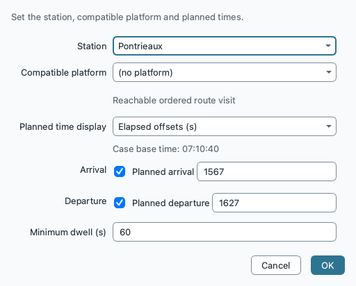
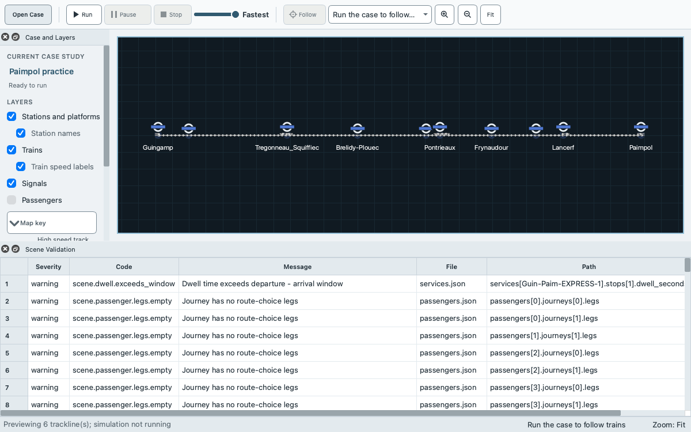

# Tutorial: modify a supplied case

This tutorial changes a copy of the Paimpol case study and follows the change through validation, saving, reopening, a run and a comparison of delays. You learn how to edit a case without touching the supplied one, which edits clear results, and how to see that a saved edit is still there after you quit and start again.

You need EGTRAIN running with the case study Paimpol available, and you should have done [Getting started](getting-started.md) once, so that opening a case, running it and reading the Run Results are familiar. The words case study, scenario and baseline are in the [glossary](glossary.md). The steps take the Paimpol timetable as it is committed and use the labels of the current program.

Save the supplied case under a new name with **File > Save Case Study As...** before you change anything, and never save into the supplied case. The example cases of an installed copy are protected: **File > Save Scene** on one of them asks for a new bundle name instead of writing. A scene folder anywhere else is not protected, for example the `Scenes` folder of a source checkout, where **Save Scene** writes into the committed files.

## 1. Open Paimpol and save a working copy

1. Open `Paimpol` from **Bundled cases** in the **Open a Case** window (toolbar button **Open Case**), as in [Getting started](getting-started.md). The title bar reads `EGTRAIN - Paimpol` and the dock **Case and Layers** shows "Ready to run".
2. Choose **File > Save Case Study As...**. The dialog **Save Case Study As** starts in your Documents folder when the case comes from the installation, or in your home folder when there is no Documents folder. Name the file `paimpol-practice.egscene` and save it. EGTRAIN adds `.egscene` when you leave it out.
3. The window now holds the copy: **File > Save Scene** writes to `paimpol-practice.egscene`, and **File > Recent Scenes** lists it. The scene inside still has the name `Paimpol`, so the title bar does not tell the copy from the original, and a run of the copy would write to the same output folder as a run of the original ([Output folder](command-line.md#output-folder)).
4. Give the copy its own name. Open the dock **Case Settings** (**Editors > Case Settings**), replace **Name** with `Paimpol practice` and press Enter. The title bar now reads `EGTRAIN - Paimpol practice`, with the platform's mark for unsaved changes.
5. Choose **File > Save Scene**. The mark goes and the status bar reads "Scene saved".

If the dialog answers "Installed example scenes cannot be overwritten. Choose a location outside the EGTRAIN installation.", choose another folder.

## 2. Run the copy once

Choose **Run** in the toolbar, check the dialog **Run simulation**, and choose its button **Run simulation**. When the status bar reads "Simulation complete", the dock **Run Results** opens. Choose **Open result view... > Timetable** and find the rows of `Guin-Paim-EXPRESS-1-1`. Note the columns **Arrival delay** and **Departure delay**.

The numbers in this tutorial were not read from the window. They come from runs without a window, made as in [Check the copy outside the window](#check-the-copy-outside-the-window) with `-g 0`, and read from the simulated times in `TrainTrajectories/TimetablePoints.txt` in the output folder of the run and the planned times in `services.json`. The delay is the simulated time minus the planned time. For the unchanged case the run gave:

| Station | Arrival delay | Departure delay |
| --- | --- | --- |
| Pontrieaux | +13 s | +13 s |
| Paimpol | 23 s early | none planned |

Close the timetable window. The window should show the same values.

## 3. Change a dwell and a performance

Both edits are to the service `Guin-Paim-EXPRESS-1`, the train that runs from Guingamp to Paimpol and stops at Pontrieaux on the way.

1. Open the dock **Services** (**Editors > Services**) and choose `Guin-Paim-EXPRESS-1` in the list. The dock has the tabs **Service**, **Timetable** and **Run occurrences**.
2. Open the tab **Timetable** and click the row `Pontrieaux` in the table of stops. The dialog **Edit timetable stop** opens.

   
3. Try **Cancel** first: change **Minimum dwell (s)** from 60 to 999 and choose **Cancel**. The row still shows 60 and the title bar shows no mark for unsaved changes.
4. Click the row again, enter `180` in **Minimum dwell (s)** and choose **OK**. **OK** applies all fields of the dialog together. The row shows 180 and the title bar shows the mark.
5. Open the tab **Service**, set **Running performance (parameter) %** to `80` and press Enter. The field accepts 1 to 100; 100 is the committed value.

A dwell longer than the window between the planned arrival and departure is allowed but is reported, as the next step shows.

## 4. Validate

Choose **View > Scene Validation** (Ctrl+Shift+V). The columns are **Severity**, **Code**, **Message**, **File**, **Path** and **Suggested Fix**. Paimpol opens with no errors and 371 warnings: 369 passenger journeys without route-choice legs and 2 final blocks that are clipped. `scene_tool validate --runnable` counts them in the same way. Your edit adds one warning:

- Code `scene.dwell.exceeds_window`, message "Dwell time exceeds departure - arrival window", path `services[Guin-Paim-EXPRESS-1].stops[1].dwell_seconds`.



A warning does not block a run. An error does: **Run** is disabled and the dock **Case and Layers** shows the first error instead of "Ready to run". **Edit > Undo** takes an edit back. Normal mode hides the warning counts in the status bar; **View > Advanced / Developer details** shows them.

## 5. Save, reopen from Recent Scenes, and check the original

1. Choose **File > Save Scene**. This writes `paimpol-practice.egscene`.
2. Open the original: choose **Open Case** in the toolbar, then `Paimpol` under **Bundled cases**. Open the dock **Services** again and choose `Guin-Paim-EXPRESS-1` in the list. On the tab **Service**, **Running performance (parameter) %** is 100. On the tab **Timetable**, the row Pontrieaux has dwell 60. The original is as it was.
3. Choose **File > Recent Scenes** > `paimpol-practice`, then `Guin-Paim-EXPRESS-1` in the list in the dock **Services**. The row Pontrieaux has dwell 180 and the performance is 80. The title bar reads `EGTRAIN - Paimpol practice`.

The supplied case is a scene folder, not a file, and the second step above shows that its values are as they were. In a source checkout, a save into that folder rewrites its JSON files with the indentation that EGTRAIN writes, so `git status` lists the files whose committed layout differs, such as `rolling_stock.json` and `passengers.json`, even when no value changed. `git checkout -- EGTRAIN/QEGTRAIN/Scenes/Paimpol` restores the committed files.

In an installed copy, copy the folder before step 1 and compare it with the installed folder afterwards. On macOS the installed folder is `/Applications/QEGTRAIN.app/Contents/Resources/Scenes/Paimpol`:

```bash
cp -R /Applications/QEGTRAIN.app/Contents/Resources/Scenes/Paimpol ~/Paimpol.before
diff -r ~/Paimpol.before /Applications/QEGTRAIN.app/Contents/Resources/Scenes/Paimpol
```

`diff` prints nothing when the folders are the same.

## 6. Run the edited copy

Choose **Run** and **Run simulation** again. The dock **Run Results** now shows a **Performance (%)** of 80.0 for the express and 100.0 for the other train. In **Open result view... > Timetable**, `Guin-Paim-EXPRESS-1-1` is later than in step 2. The run without a window gave:

| Station | Arrival delay | Departure delay |
| --- | --- | --- |
| Pontrieaux | +61 s | +181 s |
| Paimpol | +167 s | none planned |

The other train, `Guin-Paim-ALL-STOPS-1-1`, has the same times as before.

## 7. Add an incident scenario and compare delays

A comparison needs two runs of the same case: a baseline without incidents or entrance delays, and a scenario that has them. The order matters because every edit clears the baseline ([the table below](#what-clears-results-and-the-baseline)). Make the scenario first, then run both.

1. Open the dock **Incidents** (**Editors > Incidents**). The list **Scenarios** has one row, for the scenario `baseline` (named Baseline), with 0 incident(s), 0 delay(s) and the marker `default`. With it selected, choose **Duplicate** (**Blank** makes an empty scenario instead). The new scenario `baseline_copy` is selected. Replace **Name** with `Express breakdown`.
2. Open the tab **Incidents** of the dock and choose **Add Incident**. Set **Type** to `train_breakdown` and **Target** to `Guin-Paim-EXPRESS-1-1 | route route6 | entry +10 s`. Enter `900` in **Start (s)**. Leave **Use recovery end (s)** ticked and enter `1200` in the field below it, leave **Reduced speed cap** unticked, and press Enter after each number. The train stops at 900 s and recovers at 1200 s. For a signal failure, the icon button **Pick** beside **Target** takes the block of the signal head that you click on the network view.
3. Choose **File > Save Scene**. The list marks the scenario `modified` until you save. Saving does not clear results or the baseline.
4. Choose `baseline` in the list. Choosing a scenario is not an edit. Choose **Run** and check that the dialog **Run simulation** says **Active incidents** 0 and the scenario `baseline`. After "Simulation complete", choose **Set delay baseline** in the dock **Run Results**. The line under **Delay comparison** now starts with `Baseline: Paimpol practice / baseline`.
5. Choose `baseline_copy` in the list. The results are cleared, so the dock **Run Results** and the **Replay** row close, and the baseline stays. The entry of the menu **View** that starts with Run Results opens the dock again, as in the picture below. Choose **Run**; the dialog now says **Active incidents** 1. After "Simulation complete", choose **Compare delays**.
6. The window **Delay analysis** opens on the tab **Against baseline**. `Guin-Paim-EXPRESS-1` has a positive additional delay at Paimpol. The run without a window, with `baseline_copy` as the default scenario, gave 343 s: the arrival at Paimpol moves from 2866 s to 3209 s. `Guin-Paim-ALL-STOPS-1` is Same. How to read the window, and what it does not claim, is in [How delays are calculated](delay-analysis.md#the-delay-analysis-window).

   

After any edit, **Compare delays** is disabled and the line above the buttons in **Run Results** reads "Delay baseline cleared after a case edit. Complete a run with no incidents or entrance delays to set a new baseline." until a run completes. Repeat step 4 and step 5. If the tab **Against baseline** lists reasons instead of a difference, the two runs do not match in another way. For example, the selection on the tab **Run occurrences** of **Services** differs between the runs, and the tab says that an occurrence is in one run only. Keep every occurrence selected, because the two runs must hold the same trains.

## What clears results and the baseline

Results are the Run Results table, the result windows opened from it and the replay. The baseline is the run frozen by **Set delay baseline**. Both live in memory only.

| Action | Results and replay | Delay baseline |
| --- | --- | --- |
| Any edit in an editor dock, including a scenario or incident edit, and **Edit > Undo** or **Redo** | Cleared | Cleared |
| Choosing another scenario in the dock **Incidents** | Cleared | Kept |
| Starting a run | Replaced by the new run | Kept |
| A run that you stop | None kept | Kept |
| **File > Save Scene**, **Save Case Study As...**, **Save Scene As Folder...** | Kept | Kept |
| Opening a case (also from **Recent Scenes**), **New Case Study...**, **Load Legacy Case...**, recovering unsaved work | Cleared | Cleared |
| Opening a result window, **Export CSV...**, **Compare delays** | Kept | Kept |
| Quitting EGTRAIN | Lost | Lost |

## 8. Quit, relaunch and confirm that the edits persisted

1. Choose **File > Quit** (on macOS, the Quit entry of the application menu). If the title bar still shows the mark for unsaved changes, EGTRAIN asks about them (the box is titled **Unsaved Scene** on Windows and Linux, and is a sheet without a title on macOS); choose **Save**.
2. Start EGTRAIN again. In **Open a Case**, choose `paimpol-practice` under **Recent cases** and **Open**. **File > Recent Scenes** does the same from the window.
3. In **Services**, `Guin-Paim-EXPRESS-1` has dwell 180 at Pontrieaux and performance 80. In **Incidents**, the list holds `baseline` and `baseline_copy` with one incident. The scenario that is selected after opening is the default, `baseline`.
4. The Run Results are empty and **Compare delays** is disabled: results and the baseline were not saved. Run both scenarios again to compare.

## Check the copy outside the window

The saved bundle is an ordinary case study ([command-line tools](command-line.md#scene_tool)). The programs are not on the search path. Use their full paths. In the macOS app they are `/Applications/QEGTRAIN.app/Contents/MacOS/scene_tool` and `/Applications/QEGTRAIN.app/Contents/MacOS/QEGTRAIN`. In the Windows installation or the unzipped portable folder they are `scene_tool.exe` and `QEGTRAIN.exe` next to each other. In a build from source, run from `EGTRAIN/QEGTRAIN` and use `../../build/scene_tool` and `../../build/QEGTRAIN.app/Contents/MacOS/QEGTRAIN` (on Linux `../../build/QEGTRAIN`). With the macOS app and the bundle in the current folder:

```bash
APP=/Applications/QEGTRAIN.app/Contents/MacOS
"$APP/scene_tool" validate --runnable paimpol-practice.egscene
"$APP/QEGTRAIN" --scene paimpol-practice.egscene -g 0
```

The first command prints the diagnostics and exits with 0 when there is no error. The second runs the default scenario, `baseline`, without a window, and writes the [run output](run-output.md) to the folder named `Paimpol practice`. To run the scenario `baseline_copy` this way, make it the default scenario in `scenarios.json` of a folder saved with **Save Scene As Folder...**, as in the next section.

## Limits and the JSON route

- The editors are tables, lists and dialogs. The network view can give an incident its target, with **Pick** beside **Target**, and add one with **Add signal failure** in the context menu of a signal head or **Add train breakdown** in that of a train after a run. You set the other fields of the incident in the dock.
- This tutorial changes one value at a time. For many changes at once, save the case with **File > Save Scene As Folder...** and edit the JSON files, then validate with `scene_tool validate`. The keys are in [editing examples](scene-schema.md#editing-examples) and the [schema reference](scene-schema.md).
- The same two edits in `services.json` are `"performance_percent": 80` on the service and `"dwell_seconds": 180` on its second stop.
- The same scenario is the object below in the list `scenarios` of `scenarios.json`. It has the incident id that the editor proposes (`new_incident`) and the scenario id that **Duplicate** proposes. The key `default_scenario_id` in that file names the scenario that a run without a window uses; set it to `baseline_copy` for that run.

```json
{
  "id": "baseline_copy",
  "name": "Express breakdown",
  "incidents": [
    {
      "id": "new_incident",
      "type": "train_breakdown",
      "target": "Guin-Paim-EXPRESS-1",
      "occurrence": 1,
      "start_seconds": 900,
      "end_seconds": 1200
    }
  ],
  "entrance_delays": []
}
```

- **Import JSON...** and **Export JSON...** in the dock **Incidents** exchange one scenario object like this one ([scenarios](scenarios.md#scenarios)).
- The times in this tutorial are elapsed seconds from the base time of the case, which is 07:10:40 in Paimpol.

## If something does not work

- **Run** is disabled: the dock **Case and Layers** names the first error. Fix it in the dock **Scene Validation** or take the last edit back with **Edit > Undo**.
- **Compare delays** is disabled: the tooltip says what is missing. Set the baseline from a run with no incidents and no entrance delays, then run a scenario that has them, without editing in between. After an edit, run both again.
- The numbers differ from the tables: check that the dwell is 180, the performance is 80, and that you ran the scenarios named in the steps.

For the other tasks see [How-to recipes](how-to.md), and to build a case from nothing see [Tutorial: the smallest useful scene](tutorial-minimal-scene.md).
