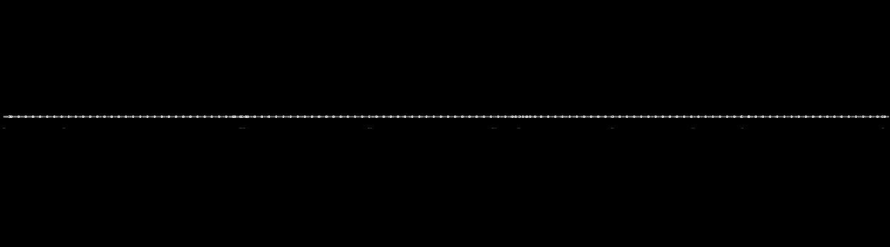
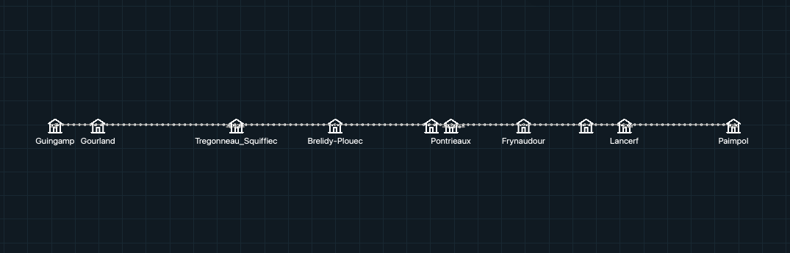
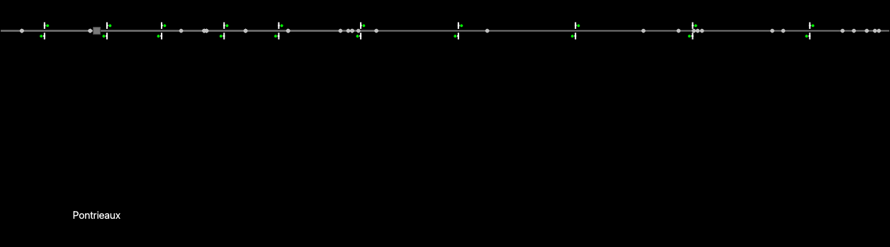
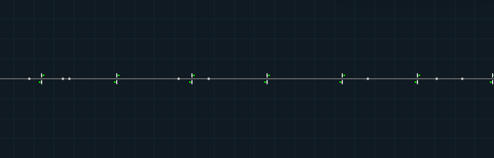
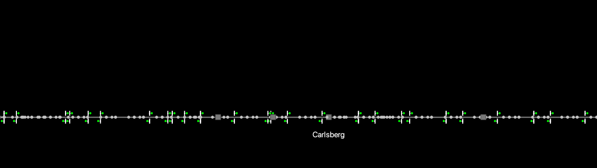
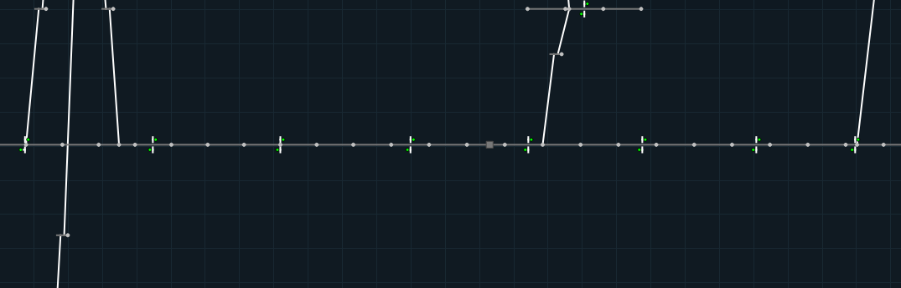
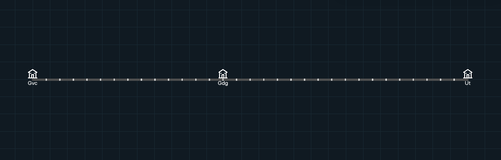
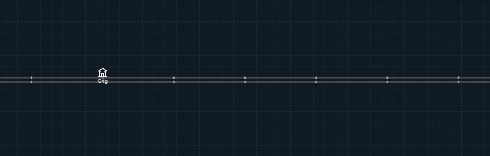

# Historical track presentation

The visual reference is the initial imported renderer `472d0b5`, particularly
`paintNode`, `paintStationNode`, `paintStationIcon`, `paintStationName`,
`arcDrawing`, `paintConnection`, `paintSignal` and `paintTrain`. The later
`f138134` manifest repair does not change these symbols. The
[renderer style map](renderer-style-map.md) gives the historical function of each
primitive next to the way it is drawn now.

Canonical authored geometry and Fit padding remain in use, so comparisons must
distinguish geometry from symbol presentation. Station artwork uses a
station-building SVG while retaining the historical scene-space anchor, offset
and parent. Its size on screen is at least 24 px for the pictogram and 12 px for
the name, so stations stay locatable at Fit; above that the scene size applies.
Overlapping names are hidden by priority and pictograms are never hidden. The
historical passenger PNG is restored as a separate resource. Train polygons keep
the historical construction; their colour is one default yellow, or the colour
of the service. The original renderer did not paint a train category badge over
the locomotive.

## Intentional differences

These are the only intentional differences from the reference renderer. A
difference that is not listed here is not intended. The numbers are the pull
requests that made the change, or the issue where none did.

- Station pictogram and its size on screen (#579). A white station-building SVG
  replaces the raster `station_pixmap`. At overview zoom the pictogram is at
  least 24 px high and the name at least 12 px, and names that overlap are
  hidden by rank. Above those sizes the scene size applies, as in the reference.
- Canvas (#509). The background `#101a22` with a faint `#182832` grid replaces
  the solid black background.
- Selection (#606). A ring in the cue colour (61,214,255) marks the selected
  item. The reference recoloured the item blue with `myQGraphicsColorizeEffect`.
- Train colours (#549, #555, #572). One default yellow, (235,210,55) with
  outline (110,90,20), replaces the keyword colours that `classifyTrainType`
  gave to freight, high speed, sprinter and intercity trains. It is the colour
  the reference gave every other train. A service with a valid colour overrides
  it on the canvas (#555) and in the result windows (#572).
- Signal head states (#586). A head without signalling data is an empty gray
  ring and a failed head is a red lamp. A head at least 6 device pixels wide also
  draws a mark: a white cross on a failed head, a dark bar on Stop, a dark dot on
  Caution and a short gray dash in the ring. The reference painted every head
  green, yellow or red and kept the colour for a code it did not know. Only a lit
  head, every state except the gray ring, has the hairline outline of the
  reference. Heads in the preview before a run stay green.
- Presentation scale (#422). Symbol sizes, text and offsets are converted from
  the historical construction units by the factor `k` described under
  [Measured presentation units](#measured-presentation-units).
- Station name spacing (issue #387). `StationOverlayItem::displayName` puts a
  space before a capital that follows a lowercase letter and before the capital
  that starts a word after an acronym. The reference put a space before every
  capital after the first letter, so `KBHallen` reads "KB Hallen" instead of
  "K B Hallen" and `Pontrieaux_Halte` has no space after the underscore. In the
  committed scenes this changes 4 of the 10 names in Paimpol and 5 of the 94 in
  Copenhagen.
- Track states (issue #387). Occupied, blocked and prepared sections are kept in
  the scene data and shown in the arc inspector, but `TrackLineItem::paint`
  ignores the state. The reference painted a block occupied by a train red.
- Running state (issue #387). The reference gave every track a white colour
  effect at the start of each step, in `releaseBlockOccupationStatus`. The
  current renderer keeps the speed-class colours during a run.

## Geometry and data differences

These differences come from the canonical scenes or from the historical input,
not from the renderer, and are not on the list above.

- Paimpol: the current frames show a siding next to Pontrieaux, joined to the
  main line by two diagonal connections. The reference frames of the same line
  show the main line only. The Paimpol historical blank mainline level and
  Guingamp anchor mismatch remain excluded layout and data differences.
- Copenhagen: the reference frames show one line. The current frame at the
  junction also shows vertical connectors between lines. Canonical geometry
  draws every authored segment, and the case-specific arc and endpoint omissions
  of the reference are not restored.
- Netherlands: the reference build `472d0b5` opens the case without trains and
  draws only a partial polyline, also after Fit, so it gives no pair for a
  comparison at a useful scale. The current build draws the whole network.

## Preview and runtime infrastructure

Normal Open now draws semantic track, connection, ordinary-node and station-node
items before Run, using the same paint classes as prepared runtime. Preview and
run draw the connections first and the track lines over them with the same pens,
and a lit signal head has a hairline outline in both. Preview has
canonical string identities and read-only inspectors, not native simulation
objects. White platform bars use the existing passenger-GUI mode; preview does
not invent passenger counters. Inspection does not select an editor row or
modify authored geometry. Rebuild, replacement and Run clear preview inspection
and close menus; delayed menu actions re-resolve identities with revision and
mode guards.

For runnable directed chains, preview mirrors the current runtime node rule:
the first point is ordinary even if a station belongs there; ordinary start
points on a four-node track have zero painted size, while station overrides at
later points and the final endpoint remain visible. Invisible ordinary nodes
retain picking targets. Four nodes alone do not establish a Copenhagen double
switch. All authored segments remain; historical case-specific arc and endpoint
omissions are not restored. Malformed fallback chains have safe authoring
preview coverage, not a prepared-runtime equivalence claim.

Station artwork retains its own canonical identity, including duplicate names
and position-only stations. Platform membership follows authored-order native
field assignments; a later position-only membership replaces the station but
retains any prior platform. Position-only artwork searches visible cached lines
in authored order. Positions outside every visible line remain unsupported for
comparison. Artwork and name visibility do not hide structural station squares.

Offscreen semantic, identity, lifetime and prepared-runtime checks are not
calibrated visual acceptance. The [evidence](#evidence) lists the captures that
compare the two renderers and what they do not cover.

## Measured presentation units

Historical projection construction used width 100, height 30 and `geo_scale`
800000 in Paimpol, Netherlands and Copenhagen. The renderer uses that fixed
reference convention, `Q_h = 800000 * 100 / 360`, not the current window size or
Fit scale. TrackPreview records its actual coordinate normalization `S_c` and
converts historical presentation distances by `k = S_c / Q_h`. On the committed
scenes this gives Paimpol 0.45, Netherlands approximately 0.444237158 and Copenhagen
approximately 0.397828422. Assignment has no historical capture reference.

Conversion requires every visible nonempty line to complete the authored
station-view projection, whether schematic or geographic. Raw coordinates,
missing views, invalid anchors, mixed/partially mapped scenes, empty or degenerate
extents and nonfinite normalization retain presentation factor 1 for the whole
scene. Hidden lines do not qualify or disqualify the visible scene. Normalization
is idempotent, including its unit metadata; edits rebuild from the scene model.

Station artwork, its vertical gap, text metrics, derived annotation offsets and
named nudges, structural nodes, signal heads/lateral separation, platforms,
passenger adornments, train thickness and callout decoration use this shared
conversion. Original font and pixmap metrics are retained with fractional item
scaling. Authored coordinates, levels, track geometry, physical train head/tail
and length, and signal center/longitudinal +/-8 metre anchors do not scale again.
Track, connection and signal strokes stay cosmetic. Picking areas are preserved.
The Paimpol historical blank mainline level and Guingamp anchor mismatch remain
excluded layout/data differences, not presentation calibration inputs.

Focused unit and offscreen preview/prepared-runtime fixtures verify these unit
boundaries. They do not establish full historical visual acceptance or replace
matched-extent application captures and manual interaction checks.

## Evidence

The captures compare the reference build with the current build in a macOS guest.
Both windows are maximised on a 1280x800 display at device pixel ratio 1, and each
image is cropped to the network canvas. The reference build has no side dock, so
its canvas is 1256 px wide against 1075 px for the current one, and the
Copenhagen reference image stops at 1240 px, before a scroll bar. Each image
names the build, the scene and the zoom. Both builds zoom by 1.15 per click. The
zoom label of the current build is the ratio to its own Fit scale. The reference
build has no zoom label, so its zoom is the number of zoom-in clicks from Fit.

### Paimpol at Fit

Build `472d0b5`, scene Paimpol, 1280x800, device pixel ratio 1, Fit.

Build main `037a2e43`, scene Paimpol, 1280x800, device pixel ratio 1, zoom label Fit.

### Paimpol at detail

Build `472d0b5`, scene Paimpol, 1280x800, device pixel ratio 1, 20 zoom-in clicks from Fit.

Build main `037a2e43`, scene Paimpol, 1280x800, device pixel ratio 1, zoom label 21.6x.

### Copenhagen junction

Build `472d0b5`, scene Copenhagen, 1280x800, device pixel ratio 1, 26 zoom-in clicks from Fit.

Build main `037a2e43`, scene Copenhagen, 1280x800, device pixel ratio 1, zoom label 37.9x.

### Assignment corridor

The reference build has no capture of this scene, so only the current build is shown.

Build main `2524aa13`, scene Assignment_Gvc_Gdg_Ut, 1280x800, device pixel ratio 1, zoom label Fit.

Build main `2524aa13`, scene Assignment_Gvc_Gdg_Ut, 1280x800, device pixel ratio 1, zoom label 5.4x.

### What the captures show and do not show

- The two builds fit differently: the reference build fits the scene rectangle
  and the current build fits the painted track with 24 px of padding. The Fit
  frames and the zoom counts therefore do not give one scale on screen.
- In the Paimpol detail pair the evenly spaced signals are about 165 px apart in
  the reference frame and 164 px in the current frame, so the scale matches. The
  frames show different stretches of the line: the reference frame includes a
  station and the current frame does not.
- The Copenhagen pair compares symbols only. The frames show different places
  at different scales: the node dots of the main line are about 12 px apart in
  the reference frame and 44 px in the current one.
- In both Paimpol detail frames a signal has a white post and base and a green
  head (0,255,0), and the opposing head sits on the other side of the line at
  the same offsets. Node dots are light gray (192,192,192) and sit at the ends of
  the track segments. The track is (120,120,120) and its stroke covers 2 device
  pixels, which the reference frame spreads over three pixel rows.
- The Assignment detail frame shows the two parallel tracks of the corridor.
- No capture shows a running state, so the red and yellow aspects, the unpainted
  track states and the white repaint of the reference are not shown.
- Interaction (hit testing, signal inspection, layer toggles, Follow, zoom and
  pan) and the run, pause, stop and replay states are not shown by these
  captures.
